# 面向学术文献元数据采集与主题可视化分析系统研究与实现

> 2026届本科毕业设计终稿（2026-05-28）。源文件：`D:/毕设相关/2026届毕业设计（论文）撰写格式（计算机学院模板）/面向学术文献元数据采集与主题可视化分析系统研究与实现.docx`；插图见 `figures/`（按图号命名）。

## 摘要

在学术文献快速增长的背景下，传统文献的分析工具有采集能力不足、深度挖掘能力欠缺和架构扩展性弱等问题。对此，本文设计并实现了面向学术文献元数据采集与主题可视化分析系统。系统采用了低耦合的模块化设计，分为分布式爬虫管理与数据分析两个模块：分布式爬虫管理模块基于Master-Worker架构实现了分布式任务调度、节点监控与故障转移等功能，并支持插件化扩展；数据分析模块实现了文本预处理、潜在狄利克雷分配和多维度交互式可视化等功能。经过系统测试，系统可以完成大量文献元数据采集，并能有效挖掘学科研究主题和演化规律，能够提升科研效率，同时为同类学术分析系统研发提供参考。

关键词： 学术文献分析、分布式爬虫、元数据采集、潜在狄利克雷分配、数据可视化

## ABSTRACT

Now the number of academic literature has been growing rapidly, the original commonly used traditional literature analysis tools slowly exposed a lot of shortcomings, first of all, the ability to obtain literature is not strong enough, secondly, the depth of the content of the literature can not keep up with the demand, and the scalability of their own architecture is relatively weak. In order to solve these practical problems, this paper has designed and made a system of metadata collection and topic visual analysis specifically for academic literature. The system uses a low-coupling modular design idea, which is divided into two core modules, one is a distributed crawler management module and the other is a data analysis module. Among them, the distributed crawler management module based on the Master-Worker architecture implements practical functions such as distributed task scheduling, node monitoring and failover, and also supports functional expansion by plug-ins. The data analysis module is also rich in functionality, with text preprocessing, Latent Dirichlet Allocation, and multi-dimensional interactive visualization. The results obtained after we have completed the system test can show that the system can successfully complete the metadata collection work of a large number of academic literature, and can effectively excavate the research topics and evolutionary laws of corresponding disciplines, and can help researchers improve the efficiency of scientific research. The design and implementation of this system can also provide a reference for the development of similar academic analysis systems.

Keywords: Academic Literature Analysis, Distributed Crawler, Metadata Acquisition, Latent Dirichlet Allocation, Data Visualization

## 第1章 引言

### 1.1 背景

当前学术环境下，科学技术发展快速，并且全球的科研投入都在持续增加，因此，学术文献的产出量日益增长。根据相关学者统计，全球每年新增的学术论文数量超过了300万篇，并且仍然在以大约每年5%的速度持续增长[1-2]。如此多的学术文献中有着大量的知识信息，包含了各个学科领域的相关研究进展和发展趋势，同时也是学者获取前沿知识和寻找研究方向的重要途径[3]。

然而，快速增长的学术文献数量也给学者造成了相当多的麻烦。基础的文献检索方式只能通过关键词匹配或筛选来获取所需的文献，无法全面地研究整体的研究格局和热点主题的变化趋势 [4-5]。学者有时需要花费很多不必要时间去阅读大量的相关文献，才能系统性地了解某个研究领域，因此，这会显著地降低科研效率[6]。同时，不同的学术数据库之间的存在数据格式不统一等问题，这也给学术文献数据的研究和分析带来了许多困难[7]。

近年来，网络爬虫技术、自然语言处理技术和数据可视化技术的快速发展为解决上述问题提供了新的思路和方法。分布式爬虫技术能够高效、稳定地从多个学术数据源采集大规模文献元数据[8-9]；主题建模技术如潜在狄利克雷分配（Latent Dirichlet Allocation，简称 LDA）可以自动从海量文本中挖掘潜在的主题结构[10-12]；此外，数据可视化技术能够将抽象的数据分析结果通过直观、简洁的图形方式展示出来，能够帮助学者更快获取到所需的知识[13-14]。

虽然当前已经有了一些学术文献分析的工具，但大都存在下列缺点[15-17]：第一，工具的元数据的采集效率不高，当前的学术文献分析工具大多使用单机的爬虫架构，不能满足当前的元数据采集需求，并且没有可视化管理和监控爬虫任务[18]；第二，工具的系统架构耦合度都普遍偏高，导致功能扩展困难，并且根据不同的学科领域需求做定制开发的效率低[19]；第三，工具的数据分析功能不足，当前的学术文献分析工具大多只支持基础的统计分析和简单的可视化展示，对于主题演变等知识的深度挖掘能力有待提升[20]；第四，缺乏高可用性设计，当爬虫节点出现故障时，容易导致任务中断和数据丢失[21]。

结合上述背景，本文设计并实现了一个用来进行学术文献元数据采集和主题可视化分析的系统。该系统使用低耦合的模块化设计方法，把系统划分成分布式爬虫管理模块和数据分析模块这两个独立部分，并且通过JSON格式来完成数据交互。分布式爬虫管理模块使用WPF技术来进行开发，该模块可以支持多个Worker节点同时进行爬虫任务，并且会对任务执行状态和节点资源使用情况实行实时监控。该模块对爬虫流程进行了设计与调度，并且具备自动检测节点故障和重新分配任务的功能。数据分析模块使用Python技术开发，包括数据预处理、LDA主题建模、词云生成和趋势折线图等功能，可以协助科研人员从不同方面分析学术文献数据。

本文的意义主要表现在以下方面：该系统可以高效且稳定地获取大量学术文献的元数据，并且可以作为完整的数据源为相关学者提供服务。该系统把多种数据分析算法和可视化技术进行了整合，研究人员能够借此快速掌握相关学科领域的研究热点和发展动向，以达到提高科研工作效率的目的。该系统使用插件化模式和低耦合设计，拥有较好的可扩展性和可维护性，可以支持更多功能的扩展和定制插件的开发。最后，本文的研究成果可以为其他类似的学术数据分析系统的设计和实现提供参考。

### 1.2 国内外研究现状

随着学术文献数量的快速增长，如何高效采集文献元数据并从中挖掘有价值的研究主题，已成为学术界和工业界共同关注的热点问题。围绕这一目标，国内外学者在分布式爬虫技术、学术文本主题挖掘以及可视化分析等领域开展了大量研究。

#### 1.2.1 学术文献数据采集技术研究现状

学术文献数据采集工作中，早期系统主要采用单机爬虫模式，依靠预设规则从指定学术数据库中获取文献信息。但是，采集需求的增加，在性能和可靠性上，单机架构慢慢无法满足要求。张军等[8]提出了一种利用资源感知进行分布式爬虫任务调度的方法，该方法可以按照节点实时的CPU和内存等资源情况对爬虫任务进行动态分配，该方法可以减少集群节点之间负载倾斜的发生，并且能够提高大规模文献采集的效率。Siwik等[22]运用阶段事件驱动模式，形成了分布式可插拔爬虫平台，该平台把爬虫的各类功能分解为单独的微架构单元，这样使系统的可维护性和扩展性得到提高。刘若宇等[19]在架构设计上提出，低耦合设计会提高系统的可扩展能力，插件化方式可以方便地接入新的爬虫逻辑，并且不用改动主体代码。本文实现了一种具有插件热插拔功能的分布式爬虫模式，通过使用统一的接口规范了爬取不同网站的采集插件，从而使多源学术数据元数据采集的效率得到提高。在系统高可用性上，向清平等[20]对分布式环境中的节点故障检测和自动恢复技术进行了分析，高钰等[23]提出了面向分布式系统的失效恢复缺陷检测方法，可以识别并恢复出现故障的采集节点，从而保证整体采集任务的连续性。

#### 1.2.2 学术文本主题挖掘与可视化技术研究现状

在获取充分的学术文献元数据后，本文对主题信息进行挖掘，从而为学者的研究工作提供支持。Blei D M等[10]提出了LDA模型，该模型被广泛应用于学术文献的主题挖掘，主要因为它具有无监督和可解释性强的优点。胡泽文等[11]将LDA和Word2vec结合起来，识别图书情报领域中机器学习研究的主题变化及热点主题，使该技术可以分析主题的时序变化规律，并且提高主题挖掘的语义表示能力。Koltcov等[24]分析了主题模型稳定性、一致性和最优主题数的确定方法，Röder M等[25]提出使用滑动窗口和间接确认度量来计算主题一致性指标CV，这些研究为量化评估主题语义连贯性提供了有效的方法。Prabha等[26]分析了LDA模型的参数优化方法，利用元启发式算法得到最优参数的组合，可以提高所抽取主题的语义聚合程度和可解释性。

主题建模需要以文本预处理为基础，文本预处理的质量会影响到建模效果。Siino等[27]对比了各种预处理方式给传统模型和深度模型带来的影响，并说明了进行科学预处理非常必要。陈敬雷[12]在自然语言处理实践里整理出一套完整的预处理流水线，该流水线包括词性感知词形还原、领域停用词过滤和多字段文本融合等步骤，是英文学术文献处理的主要参考。本文对学术文献中出现的高频术语和复合词进行优化分词和标准化处理，从而提高主题建模的质量。

在可视化分析方面，陈为等[15]提供了知识可视化的研究进展，指出了交互式可视化在认知效率和洞察深度方面优于静态图表。Dang等[28]设计了面向学术主题演化分析的WordStream交互式可视化系统，该系统支持对主题分布、年度趋势和主题间距离进行多维度探索。在工具实现层面，Richards[29]展示了基于Streamlit框架的快速构建交互式数据分析应用的方法，该方法内建的会话状态管理和组件生态适用于多步骤分析流程；Talero-Sarmiento等[30]开发的ViDoe工具验证了在降低非专业用户开发门槛方面，低代码可视化方案有研究的价值。

#### 1.2.3 现有研究的不足

虽然上述研究为学术文献采集与数据分析提供了部分的技术基础，但是仍然存在以下不足：

第一，系统集成度不高。当前的分布式爬虫系统大都专注于元数据采集，缺乏和主题挖掘、可视化分析等任务的耦合，任务之间的数据流转通常需要手动导出数据并进行格式转换，无法自动化采集并分析[15-16]。

第二，架构扩展性与通用性欠缺。当前的部分系统虽然也实现了分布式采集，但是架构的耦合度较高，爬虫逻辑和调度管理之间存在紧耦合问题，而当需要接入新的学术数据源的时候，通常需要修改核心的代码，这使得维护成本较大[19]。同时，面向学术文献的专项优化比如插件化扩展和节点资源感知调度等并没有得到过充分的实践。

第三，主题挖掘深度与交互体验不足。当前的多数的分析工具只提供了基础的主题词云或简单统计图表，在主题演化趋势和主题间关联方面存在不足[20]。在可视化交互方面，当前的部分系统仍然采用静态页面进行展示，使得用户不能基于不同的需求调整分析参数和筛选条件，并且对于非专业用户的来说易用性较低。

第四，系统可靠性与容错能力有待提升。在当前的分布式采集环境中，节点故障和网络抖动等异常情况经常出现，而现有的研究中很少分析爬虫系统的高可用机制，在任务级故障恢复和节点会话管理等方面的工程化实现方面有提升的空间[21]。

综上所述，需要设计具备分布式采集能力和功能主题可视化分析能力的低耦合系统，这样能够稳定且高效地完成学术文献元数据的大量采集，并且能为学者提供可配置的主题建模和交互式可视化的系统以更快发现学科研究热点和演化规律。本文针对上述四项不足，设计了分布式爬虫管理和主题可视化分析的低耦合模块化系统，使用Master-Worker主从架构解决采集环节的可靠性和扩展性的问题，使用全流程LDA主题建模和Streamlit交互式可视化方案解决分析环节的深度和易用性问题，实现学术文献采集与分析的自动化流程，同时也是本文研究的核心。

### 1.3 研究方向

#### 1.3.1 分布式爬虫管理模块的设计与实现

分布式爬虫管理模块负责学术文献元数据的采集、任务调度和节点管理。本模块需要解决和研究的问题如下：

分布式任务调度机制设计：研究如何将大规模爬虫任务合理地分配到多个Worker节点上并行执行，从而实现任务的负载均衡[23,31]。设计任务队列和调度算法，从而确保任务能够基于算法有序执行[32]。

节点实时监控与故障转移：研究如何实时监控各个Worker节点的运行状态和资源使用情况。设计节点故障自动检测机制，当某个节点离线时，系统能够将该节点上未完成的任务重新分配到其他正常节点上重新执行，从而保证了系统的高可用性[33-34]。

插件化架构设计：研究如何设计插件化的系统架构，支持不同学术数据源的爬虫插件开发[22,35]。定义统一的插件接口规范，使得用户可以基于自身的需要开发对应的爬虫插件，从而扩展系统的数据采集能力。

#### 1.3.2 数据分析模块的设计与实现

数据分析模块负责对分布式爬虫采集到的学术文献元数据进行全流程处理和深度挖掘，实现潜在研究主题的自动识别、演化规律分析和可视化呈现。本模块需要解决和研究的问题如下：

学术文本标准化预处理流水线设计：研究适用于学术文献元数据的结构化转换和文本清洗方法，实现容错高的文本预处理流程，从而提供规范的标准化语料给主题建模部分[27,36]。

可配置化主题建模与效果评估体系构建：研究基于LDA主题模型的学术文献主题挖掘方法，解决主题模型参数调优、主题可解释性提升和模型效果量化评估等问题，设计可交互的模型参数配置界面，并实现自动标注文献的主题和直观反馈模型的性能 [24-26]。

多维度交互式可视化分析体系设计：研究学术主题分析结果的可视化呈现与交互方法，是实现全维度的可视化体系，并设计多条件联动筛选和分析结果标准化导出的能力，从而降低学者的数据分析耗时，并提升文献阅读的效率[28,37]。

## 第2章 系统需求分析

### 2.1 分布式爬虫管理模块需求分析

#### 2.1.1 功能需求分析

##### 2.1.1.1 分布式节点管理功能

系统应能接受Worker节点的登记，获取其CPU核心数、总内存、IP地址等硬件参数，并在身份验证通过后将其接纳为集群成员。

系统需实时跟踪Worker的连通性：能依据可配置的超时阈值，自动将失联节点标记为“离线”，并即时回收与其关联的系统资源（如会话上下文），避免资源泄漏。

关于节点注册和心跳上报的用例规约见表2-1。

**表2-1 节点注册和心跳上报的用例规约**

| 元素 | 描述 |
|---|---|
| 用例名称 | 节点注册与心跳上报 |
| 参与者 | Worker节点 |
| 前置条件 | Worker节点已配置管理平台的连接地址及有效认证令牌。 |
| 后置条件 | 节点信息被持久化，管理员可在界面查看该节点及其状态。 |
| 基本事件流 | 1. Worker节点启动后，向管理平台发送注册请求，携带自身硬件信息（CPU核数、内存总量、IP地址等）及认证令牌。 2. 系统验证令牌，校验通过后为该节点分配全局唯一标识，建立通信会话，节点状态设为“在线”。 3. Worker节点定期上报CPU使用率、内存使用量、磁盘使用率等实时负载数据。 4. 系统根据上报数据刷新节点状态和监控信息。 |
| 备选事件流 | 2a. 认证失败：系统拒绝注册，记录告警日志，不建立会话。 3a. 心跳超时：若系统在指定时间内未收到某节点任何报文，则将其标记为“离线”，并触发故障恢复流程。 |

##### 2.1.1.2 可视化任务调度功能

管理员应能新建爬虫任务，并为任务指定名称、起始URL、爬取深度、最大抓取数及优先级等运行参数。

系统根据任务优先级和当前集群的节点负载，自动将新任务派发到适宜的Worker执行，无需管理员手动指定节点。

管理员应能实时观察到每个任务的当前状态（等待、运行中、已完成、失败）、已爬取页面数量及执行耗时，并能查看历史任务列表。

当资源紧张时，高优先级任务应比低优先级任务更早获得执行机会。

关于创建爬虫任务的用例规约见表2-2。

**表2-2 创建爬虫任务的用例规约**

| 元素 | 描述 |
|---|---|
| 用例名称 | 创建爬虫任务 |
| 参与者 | 管理员 |
| 前置条件 | 集群中至少有一个Worker节点处于“在线”状态。 |
| 后置条件 | 新任务成功创建并纳入调度视野，其所有配置信息持久化存储。 |
| 基本事件流 | 1. 管理员打开任务创建的界面，在界面中填写任务名称、起始URL列表、爬取深度、最大页面数和优先级等必要参数。 2. 管理员点击按钮以提交任务。 3. 系统校验参数的合法性和完整性。 4. 系统生成任务记录，任务记录的初始状态设为“等待中”，并且写入持久存储。 5. 系统根据当前的节点负载和任务优先级，自动将该任务分配到合适Worker节点执行，并且在界面中更新任务状态。 |
| 备选事件流 | 2a. 参数校验不通过：系统提示具体错误，任务不创建。 5a. 当前无可用Worker：任务保持“等待中”，待有节点在线且负载允许时自动分配。 |

##### 2.1.1.3 实时性能监控功能

系统应逐节点呈现CPU使用率、内存占用量、磁盘使用率的当前数值，并支持以趋势图形式回溯这些指标的历史变化。

监控界面的数据须定期自动刷新，使管理员能及时发现性能瓶颈或异常波动。

关于实时性能监控的用例规约见表2-3。

**表2-3 实时性能监控的用例规约**

| 元素 | 描述 |
|---|---|
| 用例名称 | 查看实时性能监控 |
| 参与者 | 管理员 |
| 前置条件 | 集群中至少有一个Worker节点处于“在线”状态。 |
| 后置条件 | 管理员获取到所需节点的资源消耗情况，并可据此进行容量规划或问题诊断。 |
| 基本事件流 | 1. 管理员进入性能监控界面。 2. 系统以列表展示所有Worker节点的当前CPU使用率、内存占用量、磁盘使用率等关键指标。 3. 对于选定的节点，系统以折线图或面积图形式展示其历史趋势。 4. 数据自动刷新，无需手动操作。 |
| 备选事件流 | 2a. 某节点离线：该节点对应图表区域灰显，并标记“离线”，最新趋势停留在离线前最后一刻。 |

##### 2.1.1.4 插件化爬虫引擎功能

系统应支持不修改主体代码即可扩展新的网页抓取逻辑。管理员通过向预定义位置部署遵循系统约定的功能包，即可使系统自动识别并加载其中包含的爬虫能力。

新加载的插件与已有插件在运行时彼此隔离，任何一个插件的执行错误不得影响其他插件的任务或系统的正常运行。

允许管理员为不同插件设定独立的运行参数（例如请求间隔、超时时长、自定义标头等），以适配不同的目标站点。

##### 2.1.1.5 数据持久化存储功能

系统必须将以下数据完整地持久化保存，且在系统重启后保持可用：

集群节点注册信息及历史状态记录；

所有任务的配置、执行状态与执行结果摘要；

爬取获得的原始页面数据和抽取后的结构化内容；

包含系统运行日志、任务日志和错误日志在内的全部日志信息。

管理员应能通过条件筛选（如日志级别、时间区间、关联节点）对爬取结果和日志进行检索。

##### 2.1.1.6 智能负载均衡功能

分配任务时，系统应动态评估各在线Worker节点的即时资源占用，优先将任务分派给负载最轻的节点，使集群资源利用率整体均衡。

当新节点加入或现有节点离线时，未分配的任务应能自动调整去向，无需运维介入。

##### 2.1.1.7 故障任务恢复和节点健康检查功能

当Worker节点被判定为离线状态之后，系统应当能够自动将该节点上正在执行的任务重置为可调度状态，并通过任务调度放到其他健康节点上继续执行。

当Master意外重启后，之前所有未完成的任务（含“等待中”与“运行中”）应当能够自动恢复并重新进入调度流程，确保不会因重启而丢失任务。

系统需要具备周期性的节点健康状况判定机制：将超过预设时长仍然无响应的节点自动标记为离线，并同时触发上述的任务恢复动作。

##### 2.1.1.8 系统用例模型

分布式爬虫用例模型见图2-1


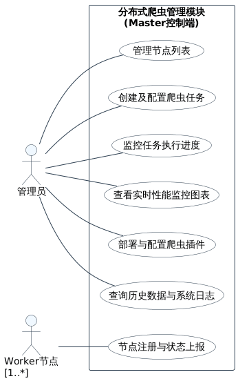

*图2-1 分布式爬虫用例模型*

#### 2.1.2 非功能需求分析

##### 2.1.2.1 可用性需求

系统需具备高可用性，确保在部分节点故障的情况下仍能正常运行[21,34]：

(1)故障检测：节点故障检测正常工作，及时发现离线节点。

(2)任务恢复：节点故障后，未完成任务能够成功重新分配。

(3)数据可靠性：爬取结果和任务数据持久化存储，系统重启后不丢失任何数据。

##### 2.1.2.2 可扩展性需求

系统需具备良好的可扩展性，支持功能和规模的扩展[19,22]：

(1)节点扩展：支持Worker节点动态横向扩展，无需重启Master节点，可随时添加或移除Worker节点。

(2)功能扩展：采用插件化架构，支持通过开发新插件扩展系统功能，无需修改系统核心代码。

##### 2.1.2.3 安全性需求

系统需具备基本的安全防护能力，防止未授权访问和数据泄露[38]：

(1)节点认证：Worker节点注册时需提供有效的认证令牌，只有通过认证的节点才能接入集群。

(2)通信安全：支持gRPC通信加密，防止数据在传输过程中被窃取或篡改。

#### 2.1.3 模块边界与约束

##### 2.1.3.1 模块边界

本模块专注于爬虫任务的分布式管理、调度和监控，是一个通用的爬虫管理平台。模块的核心功能包括节点管理、任务调度、实时监控、插件管理和流程设计。

模块不包含以下功能：

(1)反爬虫破解功能：不提供验证码识别、IP代理池管理、浏览器模拟等反爬虫破解功能。

(2)数据清洗与分析功能：不提供爬取数据的清洗、转换和分析功能。

(3)分布式存储功能：不提供分布式数据存储，所有数据存储在Master节点的本地数据库中。

模块仅与Worker节点和本地数据库进行交互，不依赖其他外部系统。

##### 2.1.3.2 技术约束

系统开发和运行需遵循以下技术约束：

(1)开发平台：基于.NET 10平台开发，使用C#编程语言，利用.NET生态系统的丰富库和工具。

(2)通信协议：采用gRPC作为Master与Worker之间的核心通信协议，使用Protobuf进行数据序列化。

(3)数据存储：使用SQLite作为本地数据库，EF Core作为ORM框架，简化数据库操作。

(4)UI框架：使用WPF作为桌面应用开发框架，MaterialDesignInXaml作为UI组件库，提供现代化的用户界面。

### 2.2 数据分析模块需求分析

#### 2.2.1 功能性需求

##### 2.2.1.1 文献数据解析与预处理功能

模块应当支持JSON格式的元数据文件的批量上传和解析，能够自动提取标题、摘要、作者、发表年份和学科分类等字段；能够完成对英文文本标准化清洗、分词、词性标注、词形还原和去停用词等全流程预处理；并支持将预处理的数据结构化、持久化地存储和读取。

##### 2.2.1.2 LDA主题模型训练与优化功能

模块应当支持用户自定义的主题数量、训练迭代次数、文档-主题先验（Alpha）和主题-词先验（Eta）等核心超参数；能够一键完成LDA模型训练，并自动计算模型评估指标包括对数困惑度和主题一致性（CV）；能够为每篇文献自动匹配最优的主导主题与对应的置信度，并生成可解释的主题标签。

##### 2.2.1.3 多维度主题可视化分析功能

模块应当支持主题文献的分布统计、主题核心词云、研究主题年度趋势和主题间距离映射等交互式可视化；并支持基于主题、发表年份和主题置信度的多条件组合筛选，得到的筛选结果能够和可视化图表实时联动；能够支持文献的原始数据表格化展示和原文跳转。

##### 2.2.1.4 数据导出功能

模块应当支持全量的带主题标注的文献数据集和当前筛选的视图下的数据集以UTF-8编码的CSV格式一键导出，以满足用户后续的二次分析和数据归档的需求。

##### 2.2.1.5 系统用例模型

数据分析用例图见图2-2。

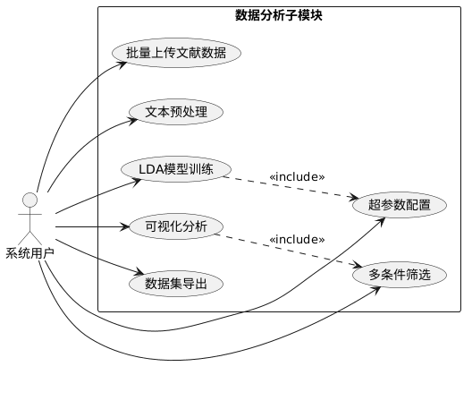

*图2-2 数据分析用例图*

#### 2.2.2 非功能性需求

##### 2.2.2.1 易用性需求

模块应当基于Web可视化界面，以实现线性的操作流程，按时序依次为上传数据、训练模型和可视化分析，所有的参数配置应当提供默认值和辅助说明，确保用户可以快速熟悉全流程操作[29-30]。

##### 2.2.2.2 性能需求

模块应当满足单批次1000条以内的文献数据预处理的耗时≤15s；满足LDA模型训练（主题数≤10、迭代次数≤20）的耗时≤100s；满足单张可视化图表渲染响应的耗时≤2s [39]。

##### 2.2.2.3 兼容性需求

模块可以在Windows和Linux等多平台上进行部署，并且兼容Chrome和Edge等主流浏览器，输入的JSON格式需要严格兼容采集子模块的输出规范，这样可以保证不需要进行二次格式转换[29]。

##### 2.2.2.4 鲁棒性需求

模块应当对无效的JSON文件、无效的文本数据、异常的参数输入和错误的文件格式等场景都有完善的异常处理机制，并给出明确的错误提示，确保不会发生程序崩溃或数据错乱等预期外的情况[40]。

### 2.3 小结

本章对系统中的两个主要模块进行了需求拆解和规范定义。针对分布式爬虫管理模块，本章确定了节点管理、任务调度、实时监控和插件化引擎等8项主要的功能需求，并且明确了系统边界和技术约束，同时量化了可用性、可扩展性和安全性这3项非功能需求。本文在数据分析模块中完成了对数据预处理、LDA主题建模、多方面可视化和数据导出等重要功能的要求定义，并且提出了对易用性、性能、兼容性和鲁棒性的非功能要求。本章形成了完整系统用例模式，确定了系统设计和实现的主要目标，并给接下来的架构设计、具体开发和测试验证提供了标准化需求基础。

## 第3章 系统总体架构设计

### 3.1 分布式爬虫管理模块总体架构设计

#### 3.1.1 架构设计原则

##### 3.1.1.1 高内聚低耦合原则

系统采用模块化设计，按功能划分为独立的模块，每个模块只负责单一职责。模块间通过定义良好的接口进行通信，不直接依赖内部实现。采用依赖注入模式，降低模块间的耦合度，提高代码的可维护性和可测试性[41]。

##### 3.1.1.2 可扩展性原则

系统运用插件化设计，把爬虫逻辑同系统中心逻辑进行分离，同时让开发者能够依靠开发新的插件来扩展系统功能 [22,35]。预留扩展接口，以保证将来可以快速地对功能进行拓展。同时对Worker节点进行动态横向扩展，并且不需要重启Master节点，这样可以满足大规模数据的采集需求。

##### 3.1.1.3 高可用性原则

系统使用无状态设计，保证Master节点在故障后可以快速进行恢复。系统通过进行节点故障自动检测和任务重新分配的方法，在某个Worker节点发生故障时，可以自动把该节点上未完成的任务分配给其他的可用节点[33-34]。系统可以支持关键数据进行持久化存储，从而防止重要数据出现丢失。

##### 3.1.1.4 易维护性原则

系统采用MVVM设计模式，分离UI与业务逻辑，使UI代码和业务逻辑代码各自独立，便于维护和修改[42]。代码结构清晰，命名规范统一，遵循C#编码规范。完善的日志系统，记录系统运行过程中的关键信息和错误信息，便于问题定位和调试。

#### 3.1.2 整体架构设计

该系统运用Master-Worker分布式模式，将系统划分成Master控制端和Worker节点两个部分[8,9]。Master控制端属于系统控制中心，该部分主要进行任务调度、节点管理、用户交互、数据存储、详情展示、JSON导出工作。Worker节点作为系统执行的单元，主要进行具体爬虫任务的执行。双方进行数据交互时利用gRPC双向流式通信方式进行[43-44]。

Master控制端运用三层架构模式，该模式是经典的MVVM架构，该架构包括UI层、ViewModel层、业务逻辑层。UI层主要进行用户交互和数据展示工作。ViewModel层主要处理UI层和业务逻辑层的数据绑定、交互，并且对UI状态进行管理。业务逻辑层包括节点管理和任务调度、负载均衡等主要服务，用来实现系统的业务逻辑。

Worker节点主要包括三个重要部分，分别是gRPC服务端、爬虫引擎和资源监控器。gRPC服务端主要负责接收Master控制端发送的指令，并且把任务执行结果和状态信息返回给Master控制端。爬虫引擎主要负责加载和运行爬虫插件，并依靠自身的算法及插件配置来完成网页爬取、解析、数据提取工作。资源监控器主要对节点的硬件资源使用情况进行采集，并且通过gRPC服务端定期向Master控制端上报心跳信息。

系统代码结构见附录，系统总体架构图见图3-1。

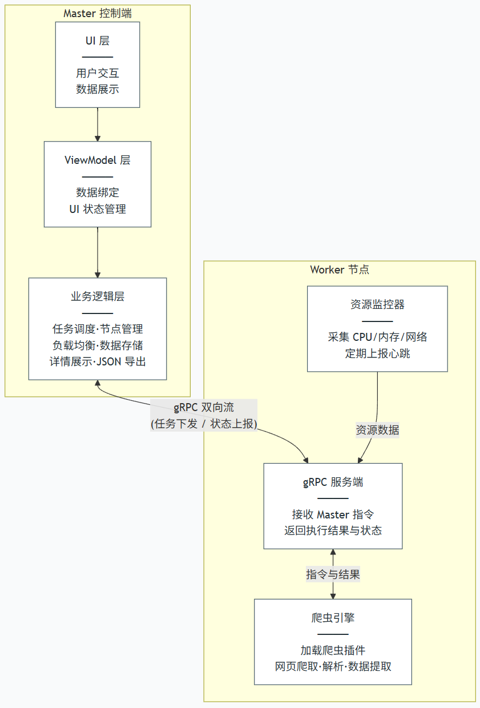

*图3-1 系统总体架构图*

#### 3.1.3 核心组件职责

##### 3.1.3.1 Master控制端组件

(1)UI层：基于WPF框架实现用户的交互界面，实现节点监控、任务管理和数据查看等功能页面。同时使用XAML进行界面设计，其中UI层和ViewModel层的交互利用数据绑定机制实现。

(2)ViewModel层：遵循MVVM模式，负责处理UI层和业务逻辑层之间的数据绑定和交互，并管理UI的状态。每个视图都有一个对应的ViewModel，负责与业务逻辑层进行数据交互，并将获得的数据转换成UI层可以展示的格式。

(3)业务逻辑层：

节点管理服务：实现节点注册、心跳处理、状态管理和清理离线节点等功能，负责管理和维护集群节点的生命周期。

任务调度服务：实现任务队列管理、优先级调度和负载均衡分配等功能，负责将所有的任务合理地分配到各个Worker节点上。

实时数据同步服务：负责将节点状态和任务进度实时推送到UI界面，实现数据的实时更新。

数据访问服务：负责与数据库进行交互，实现数据的增删改查，封装数据库操作细节。

##### 3.1.3.2 Worker节点组件

(1)gRPC服务端：该模块主要承担接收Master控制端任务指令的工作，同时把任务执行结果、心跳数据、日志信息返回给Master控制端。系统运用双向流式通信方式，Master控制端和Worker节点可以同时向对方发送消息。

(2)爬虫引擎：系统会加载并且执行爬虫插件，以此来进行网页请求、数据解析、链接提取、结果封装等任务。该引擎拥有深度限制、URL去重和爬取延迟控制等功能，可以使爬虫以高效和稳定的方式运行。

(3)资源监控器采集节点的CPU、内存和磁盘等资源使用情况，并且通过gRPC服务端定期把心跳信息上报给Master控制端。该系统运用跨平台设计，可以在物理机、虚拟机和容器环境中进行兼容。

(4)会话管理模块：该模块主要负责和Master控制端进行通信的会话管理，同时可以对断线重连和会话失效等状况进行处理，从而让系统拥有可靠的通信能力。

#### 3.1.4 系统数据流设计

##### 3.1.4.1 节点注册与连接流程

(1)Worker启动后，资源监控器采集节点静态配置信息，包括CPU核心数、总内存、IP地址、机器名等。

(2)Worker向Master发起节点注册请求，携带节点信息和认证令牌。

(3)Master验证认证令牌的有效性，验证通过后为节点分配唯一的NodeId。

(4)Worker携带NodeId和SessionId发起双向流建立请求。

(5)Master验证会话有效性，验证通过后建立双向流通道，并将节点会话与流上下文绑定。

(6)双向流建立成功后，Worker开始按配置间隔定期上报心跳。

##### 3.1.4.2 任务执行流程

(1)用户在Master UI界面创建爬虫任务，配置任务名称、爬虫插件、起始URL、爬取深度、最大页面数、优先级等参数。

(2)任务调度服务将任务加入优先级队列。

(3)调度器根据负载均衡算法，从可用节点中选择最优的Worker节点。

(4)Master通过双向流向选中的Worker发送任务指令。

(5)Worker接收任务后，验证任务参数的合法性，从插件管理器获取对应的爬虫插件。

(6)爬虫引擎加载插件，开始执行爬取任务。

(7)Worker在执行过程中，定期向Master上报任务进度和日志信息。

(8)任务完成后，Worker将爬取结果返回给Master。

(9)Master将爬取结果存储到数据库，并更新任务状态为已完成。

##### 3.1.4.3 状态同步流程

(1) Worker资源监控器按配置间隔采集实时资源指标，包括CPU使用率、内存使用量、磁盘使用率。

(2)Worker将资源指标封装为心跳消息，通过双向流上报给Master。

(3)Master接收心跳后，更新节点的最后活跃时间和资源使用情况。

(4)实时数据同步服务通过SignalR将节点状态更新推送到UI界面。

(5)UI界面接收到更新后，刷新节点监控图表和状态显示。

##### 3.1.4.4 系统核心数据流图

系统核心数据流图见图3-2。

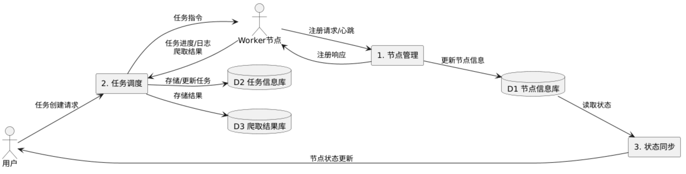

*图3-2 系统核心数据流图*

#### 3.1.5 通信架构设计

##### 3.1.5.1 通信协议选型

Master控制端和Worker节点之间的核心通信协议选用了gRPC，选择该技术主要因为以下的优势[43-44]：

(1)高性能：基于HTTP/2协议，支持多路复用，能够减少连接的开销；使用Protobuf进行二进制序列化，使得数据的体积小，能够快速序列化。

(2)双向流式通信：支持客户端和服务端同时向对方发送消息，能够满足实时通信需求，适用于当前心跳上报和任务进度推送的场景。

(3)强类型：通过.proto文件定义服务和消息结构，自动生成代码，减少手动编码错误。

##### 3.1.5.2 通信架构

系统采用客户端-服务器的模式，其中Master控制端作为gRPC服务端，Worker节点作为gRPC客户端。建立单一的双向流通道用于Master控制端和Worker节点之间的通信，该通道负责传输模块间所有的消息，能够减少连接管理的开销。

系统采用消息统一封装体，将不同类型的消息通过oneof关键字区分。Worker节点将包括心跳、爬取结果和任务进度的消息发送给Master控制端；Master控制端将包括新任务和任务控制指令的消息发送给Worker节点。这样的设计使得通信协议清晰简单，将消息处理的效率进一步提高。

##### 3.1.5.3 Master-Worker通信时序图

Master-Worker通信时序图见图3-3.

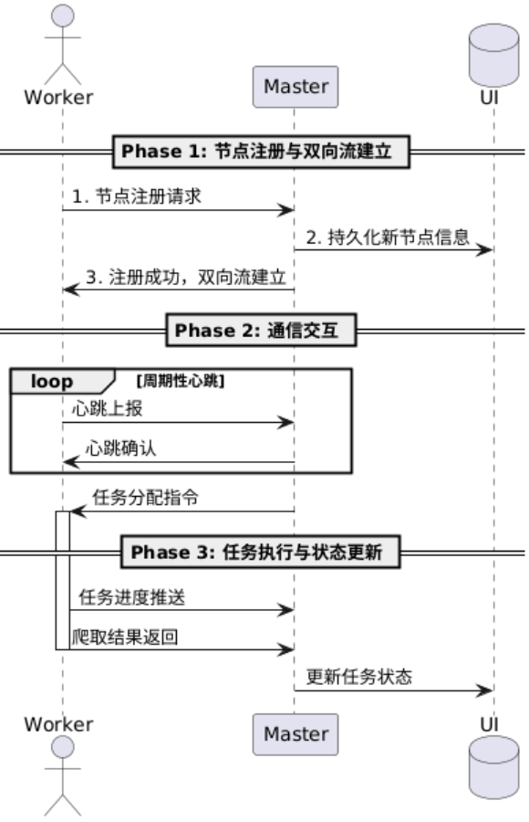

*图3-3 Master-Worker通信时序图*

### 3.2 数据分析模块架构设计

#### 3.2.1 模块分层架构

该模块运用高内聚和低耦合的分层设计方法，能够按照从上至下的顺序划分为4个单向依赖的层级。各个层级的职责非常单一，这有利于后续进行维护、对功能进行扩展[41]。分层架构的具体形式如下所示：

(1)交互层：该层是Web可视化交互界面，通过Streamlit模式实现，是用户和系统进行交互的界面[29-30]。主要职责是接收用户的文件上传、参数配置、筛选查询和数据导出等操作指令，并调用业务逻辑层的对应服务，同时把业务逻辑层返回的处理结果、评估指标和可视化图表进行渲染展示给用户。

(2)业务逻辑层：该层是子模块的主要调度层，它把整个业务流程进行串联。中心职责主要负责进行数据解析调度、预处理流程控制、模型训练调度、可视化渲染调度、数据存储和读取调度等功能，并且也实现了全局会话状态管理、全流程的异常捕获。

(3)核心算法层：该层是子模块实现功能的主要部分，可以划分为三个独立的模块：数据预处理模块DataProcessor、主题建模模块TopicModeler和可视化渲染模块Visualizer，这三个模块分别进行对文本的标准化预处理、训练和推理LDA主题模型、生成多方面交互式可视化图表。

(4)数据持久层：该层对子模块的所有数据进行存储和读取。本文把结构化文献数据集存放在SQLite数据库里，本地文件系统用来保存原始JSON文件、训练完成的LDA模型、词典和语料库文件，这可以保证数据快速地进行写入和读取。

分层架构图见图3-4。

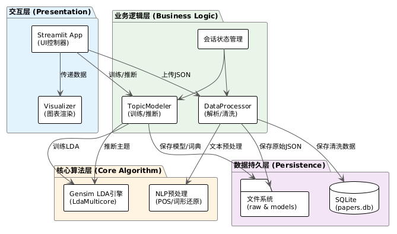

*图3-4 分层架构图*

#### 3.2.2 模块间接口设计

本模块与“分布式爬虫管理模块”之间采用文件级标准化对接，接口规范如下：

(1)输入接口：兼容采集子模块输出的标准JSON格式文献元数据，固定包含pageResults、parsedData核心节点，内置ArXivId、Title、Abstract、PublicationDate等核心字段，与本模块解析逻辑完全兼容，无需二次格式转换。

(2)输出接口：可输出带主题标注、置信度信息的CSV格式文献数据集，可直接供给用户开展后续学术分析。

模块间数据流转见图3-5。

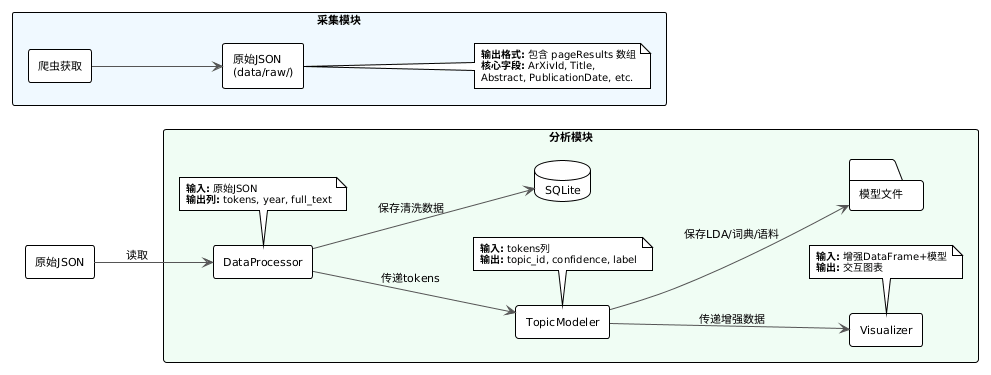

*图3-5 模块间数据流转图*

### 3.3 小结

本文遵循高内聚低耦合、高可用、可扩展和易维护这些主要设计原则，完成了系统整体架构的顶层设计和规划工作。在分布式爬虫管理模块上，本文形成了Master-Worker主从分布式模式，把Master控制端三层架构和Worker节点三项主要组件的职责进行了明确划分，并且对节点注册、任务执行、状态同步的主要数据流进行了合理规划，设计了依靠gRPC的双向流式通信模式。针对数据分析模块，本文设计了交互层、业务逻辑层、核心算法层和数据持久层四层的单向依赖分层模式，把两个模块之间标准化的数据接口和流转流程进行规范化处理。本章在顶层设计方面上对系统的模块化特性、可扩展性和高可用性进行保障，并且给出明确的架构指引，从而支持后续的系统详细设计和功能实现。

## 第4章 系统详细设计

### 4.1 分布式爬虫管理模块详细设计

#### 4.1.1 Master控制端详细设计

##### 4.1.1.1 节点管理模块

节点管理模块是Master控制端的基础模块，负责维护集群节点的生命周期。模块核心接口为INodeManagementService，定义了节点注册、获取活跃节点、更新节点心跳、移除离线节点等方法。节点管理模块类图见图4-1。

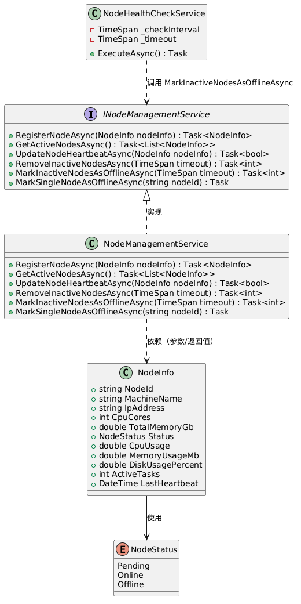

*图4-1 节点管理模块类图*

节点信息存储在NodeInfo实体类中，包含NodeId、MachineName、IpAddress

、CpuCores、TotalMemoryGb、Status、LastHeartbeatTime等字段。节点状态包括Pending（待连接）、Online（在线）和Offline（离线）三种。

节点状态转换图见图4-2。

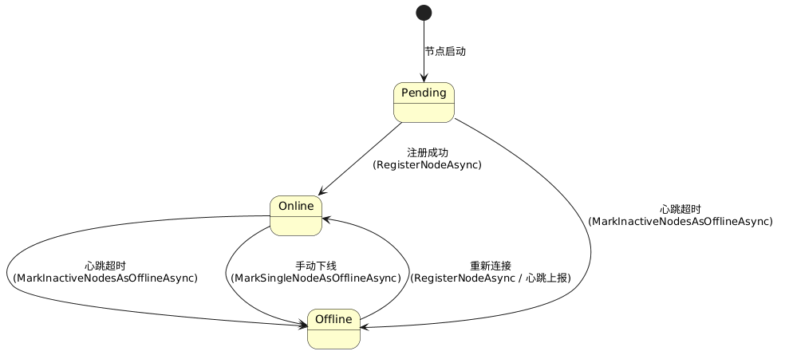

*图4-2 节点状态转换图*

系统采用心跳机制以检测节点状态，Worker节点每5秒向Master上报一次心跳。Master端的NodeHealthCheckService后台服务每30秒执行一次健康检查，将超过2分钟无心跳的节点标记为离线，并清理其相关会话信息[33]。当离线节点重新连接时，系统会自动将其状态更新为在线。

##### 4.1.1.2 任务调度模块

任务调度模块是Master控制端的核心模块，负责任务的调度和分配。模块核心接口为ITaskSchedulerService，定义了任务入队、任务分配、任务出队、恢复未完成任务等方法。

任务调度模块类图见图4-3。

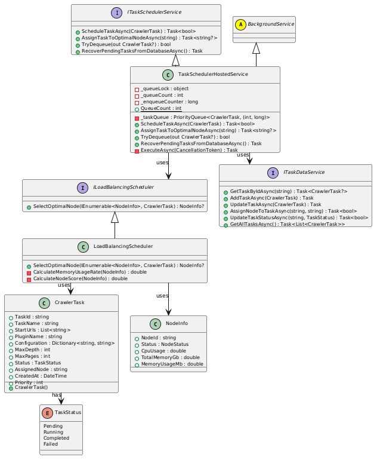

*图4-3 任务调度模块类图*

任务信息存储在CrawlerTask实体类中，包含TaskId、TaskName、StartUrls、PluginName、MaxDepth、MaxPages、Status、Priority等字段。任务状态包括Pending（待执行）、Running（执行中）、Completed（已完成）和Failed（失败）四种。

任务状态转换图见图4-4。

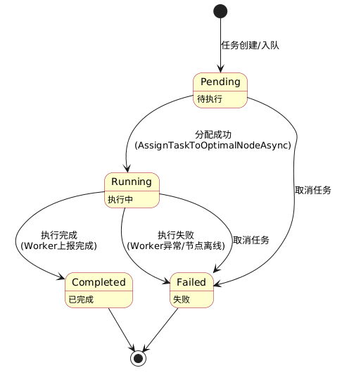

*图4-4 任务状态转换图*

任务队列利用ConcurrentPriorityQueue来完成，该队列支持高并发环境下的入队和出队操作，并且会按照用户输入任务的优先级来进行排序。任务调度器运用负载均衡算法，该算法将任务分配到最适合的可用节点进行执行[23,31]。Master控制端启动以后，会将数据库中尚未完成的Pending任务加入队列，这使得任务不会由于Master控制端重启而丢失。

##### 4.1.1.3 实时数据同步服务

实时数据同步服务通过ASP.NET Core SignalR来完成实现，该服务把节点状态和任务进度信息实时推送到UI界面。该服务定义了CrawlerHub类，其中包括NodeUpdated和TaskProgressUpdated等方法，可以实现向客户端推送数据的功能。

系统对数据更新进行节流处理，防止高频更新造成UI卡顿和网络拥塞。节点状态更新每隔5秒进行一次，任务进度更新每隔2秒进行一次。UI界面在ViewModel中对SignalR事件进行订阅，当ViewModel接收到数据更新时，它会自动对绑定的UI界面进行更新，从而实现UI实时刷新的目的。

##### 4.1.1.4 爬虫任务数据CRUD服务

Master控制端的持久化是通过爬虫任务数据CRUD服务来实现的，该服务主要负责把爬虫任务、爬取结果和单页结果进行集中存取。服务接口属于ITaskDataService，该接口在TaskDataService类中进行实现，并且它依赖CrawlerDbContext所提供的数据库上下文。任务调度、故障恢复和实时数据展示这些模块利用该服务向上提供统一的数据操作，该操作包括对任务进行的增删改查、状态更新和节点分配，也包括对爬取结果和单页结果进行的查询与分页投影。

服务中大量使用了AsNoTracking()来防止更改跟踪所消耗的开销，该做法保证了查询的性能，并且对CrawlResult.PageResults等导航属性使用按需加载的方法，防止了同时加载过多的数据。分页投影方法GetPagedCrawlResultProjectionsAsync利用LINQ的Join和GroupJoin来返回包括任务名称、结果计数的轻量级投影CrawlResultProjection，并且支持按照TaskId或者TaskName进行模糊搜索，这会减轻UI层的数据处理压力。

爬虫任务数据CRUD服务类图见图4-5。

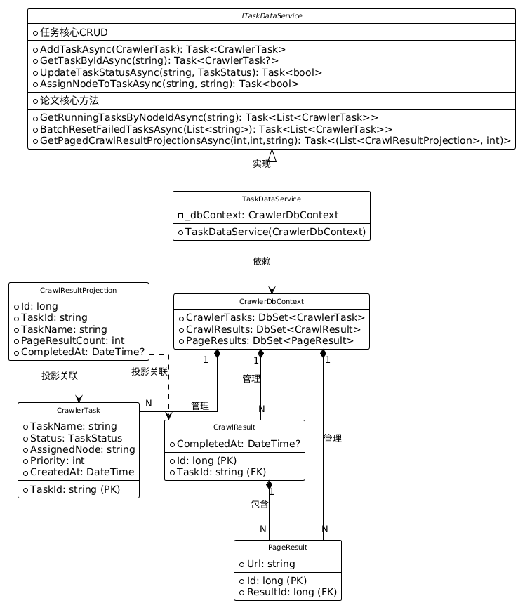

*图4-5 爬虫任务数据 CRUD 服务类图*

##### 4.1.1.5 故障任务恢复服务

Worker节点发生意外离线时，故障任务恢复服务会自动把受到影响的运行中任务重置为待执行状态，并且重新进入队列，以使任务不会因为节点宕机而出现永久中断。服务类FailedTaskRecoveryService通过IEventAggregator订阅NodeStatusChangedEventArgs事件，只有当NewStatus等于NodeStatus.Offline时才会触发，并依靠IServiceProvider创建的作用域来获取Scoped的ITaskDataService，然后通过调用ITaskSchedulerService把重置后的任务按照原来的优先级重新调度进队。

服务内部通过维护_processingNodes字典来实现同节点处理锁，从而防止高并发或网络抖动引起的重复处理，并且记录每个节点的成功处理时间_processedNodeOfflines，不考虑在30秒内同一节点的再次离线的事件。系统每隔5分钟就会对定时器的过期记录进行清理，这样可以避免内存泄漏。

具体的恢复流程如下：当出现节点离线的情况时，系统会把节点离线事件广播出去，订阅该事件的服务会获取离线节点上全部正在运行的任务，通过调用BatchResetFailedTasksAsync在事务里进行批量重置，再把重置成功的任务ID加入到故障队列_failedTaskQueue中，这个队列可被UI或者监控模块消费，接着通过ScheduleTaskAsync逐个把任务按照原来优先级入队。对全链路异常进行捕获，不会向上抛出，使进程保持稳定。

故障任务恢复时序图见图4-6。

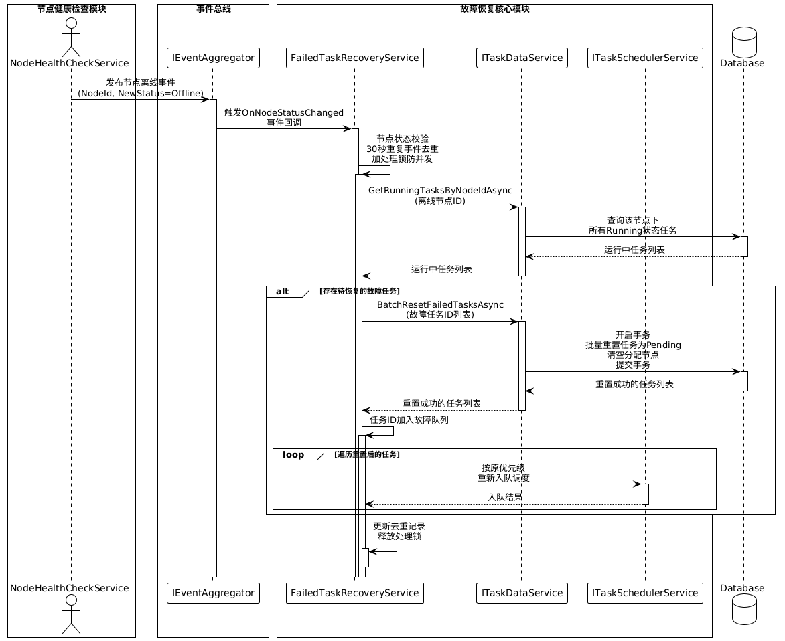

*图4-6 故障任务恢复时序图*

#### 4.1.2 Worker节点详细设计

##### 4.1.2.1 爬虫执行引擎

爬虫执行引擎是Worker节点的核心组件之一，负责执行由Master下发的爬虫任务。当Master的爬虫任务下发到引擎后，爬虫引擎会先验证任务参数的合法性，然后按照任务配置从插件管理器获取所需的爬虫插件。

引擎的爬取采用了广度优先搜索算法，同时维护了一个爬取队列和一个URL去重集合[45]。针对每个URL，引擎通过发送HTTP请求获取指定页面的内容，然后调用插件的ExecuteAsync方法解析页面，包括提取结构化数据和子链接。其中，子链接需要经过插件的ShouldFollowLink方法过滤后，方可加入爬取队列。

引擎支持深度限制、URL去重和爬取延迟控制功能。深度限制是为了防止无限递归爬取；URL去重是为了避免重复爬取到相同的页面；爬取延迟控制是为了遵守robot.txt，避免对目标网站造成过大压力。

爬虫引擎执行流程图见图4-7。

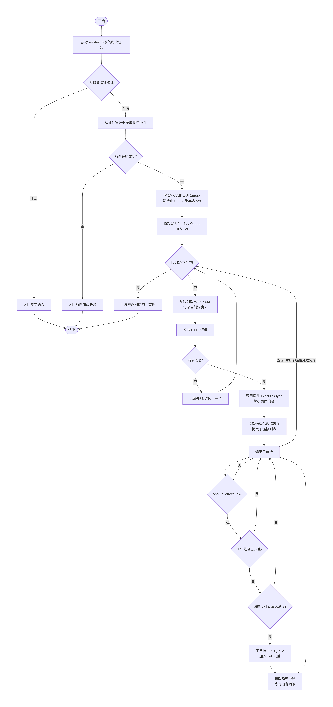

*图4-7 爬虫引擎执行流程图*

##### 4.1.2.2 资源监控器

资源监控器负责采集节点的静态配置信息和实时动态指标，实现了INodeInfoCollector接口。该接口定义了GetNodeId、CollectNodeRegistrationAsync和CollectHeartbeatAsync这三个方法。

静态配置信息采集为节点注册提供必要的配置信息，包括CPU核心数、总内存、IP地址和机器名。采集CPU核心数会优先读取cgroup v2配额，若失败则会回退到Environment.ProcessorCount；采集总内存会优先读取cgroup v2限制，若失败则会改为读取系统的物理内存；采集IP地址采用三层降级策略以获取出口IP。

实时动态指标采集所采集到的信息将会用于心跳上报，采集信息包括CPU使用率、内存使用量、磁盘使用率和活跃任务数。资源监控器采用两次采样差分算法计算CPU使用率；内存使用量在容器环境和物理机环境下会采用不同的采集方法；计算应用程序所在目录的根驱动器使用率以获得磁盘使用率。

资源监控指标采集方式表见表4-1。

**表4-1 资源监控指标采集方式表**

| 指标名称 | 单位 | 采集方式 | 容器环境兼容性 |
|---|---|---|---|
| 节点ID | - | 优先读取环境变量MASTER_NODE_ID，不存在则使用Environment.MachineName；过滤非法字符（仅保留字母、数字、下划线、连字符）并截断至 128 字符。 | 支持通过环境变量注入容器身份标识。 |
| 机器名 | - | 直接调用Environment.MachineName。 | 容器环境中返回容器主机名。 |
| CPU核心数 | 个 | 1.容器环境：读取/sys/fs/cgroup/cpu.max（cgroup v2），并解析配额与周期，然后计算Ceiling(quota/period)；若配额为"max"，则进行回退。 2.回退：使用Environment.ProcessorCount以获取系统的逻辑核心数。 | 支持 cgroup v2 CPU 限制检测；非容器环境自动降级。 |
| 总内存 | GB | 1. 容器环境：读取/sys/fs/cgroup/memory.max（cgroup v2），若为 "max" 则读取系统物理内存；否则将限制值从字节转换为 GB。 2. Linux 物理机：解析/proc/meminfo中MemTotal行（KB 转 GB）。 3. Windows：调用GlobalMemoryStatusEx获取ullTotalPhys（字节转 GB）。 | 支持 cgroup v2 内存限制；兼容物理机与虚拟机。 |
| IP地址 | - | 三层降级策略：1. UDP 连接 Master 端点（MASTER_ENDPOINT环境变量）获取出口 IP；2. DNS 解析本机名，取首个非环回 IPv4；3. 回退到127.0.0.1。 | 兼容容器网络，降级策略保证基本可用；需正确配置 Master 端点以获取准确出口 IP。 |
| CPU使用率 | % | 基于两次采样的差分算法： 1. Linux：读取/proc/stat首行 "cpu "，累加所有时间片为总时间，取 idle+iowait 为空闲时间。 2. Windows：通过NtQuerySystemInformation获取每个处理器的IdleTime、KernelTime、UserTime，汇总空闲与总忙时间。 3. 计算100 * (1 - Δidle / Δtotal)，夹紧至 0~100；首次采样返回 0。 | 容器中可读取宿主机/proc/stat或 cgroup 统计；Windows 容器兼容性依赖 API 可用性。 |
| 内存使用量 | MB | 1. 容器环境：读取/sys/fs/cgroup/memory.current，若限制为 "max" 则以系统物理内存为总内存，返回current / (1024*1024)MB。 2. Linux 物理机：解析/proc/meminfo，计算MemTotal - MemAvailable（KB 转 MB）。 3. Windows：调用GlobalMemoryStatusEx，计算ullTotalPhys - ullAvailPhys（字节转 MB）。 | 优先使用 cgroup v2 内存统计；兼容物理机与 Windows 环境。 |
| 磁盘使用率 | % | 使用DriveInfo获取应用程序根目录所在驱动器的TotalSize和AvailableFreeSpace，计算(TotalSize - AvailableFreeSpace) / TotalSize * 100。 | 部分兼容，容器内反映容器层文件系统使用率；非容器环境正常。 |
| 活跃任务数 | 个 | 代码初始化为 0，实际值由外部业务逻辑在采集后通过赋值方式更新（不参与系统资源采集）。 | 无关，不涉及系统资源探测。 |

##### 4.1.2.3 会话管理模块

会话管理模块负责管理与Master的通信会话，实现了IWorkerSessionManager接口。模块保存节点的SessionId、SystemConfig、IsRegistered和ActiveTaskCount等会话信息，处理断连重连和会话失效。

当通信链路断开时，模块会自动触发重连机制。默认重试3次，间隔1秒，超过重试次数触发全量重注册。网络恢复后，模块会自动恢复链路，并重新建立双向流通道。当Master返回会话无效时，模块会自动重新注册节点，获取新的会话标识。

##### 4.1.2.4 插件管理模块

插件管理模块负责爬虫插件的加载和管理，实现了IPluginManager接口。Worker节点启动时，插件管理器会自动扫描Plugins目录下的所有DLL文件，通过反射加载实现了ICrawlerPlugin接口的类，并将插件实例缓存到ConcurrentDictionary中，保证线程安全。

ICrawlerPlugin接口定义了爬虫插件的核心方法和属性，包括Name（插件名称）、Version（插件版本）、ExecuteAsync（执行插件解析逻辑）、GetDefaultConfiguration（获取默认配置）和ShouldFollowLink（判断是否跟随链接）[35]。插件名称全局唯一，与CrawlerTask.PluginName一致。

插件执行环境相互隔离，单个插件的异常不会影响其他插件和系统的正常运行。

插件管理模块类图见图4-8。

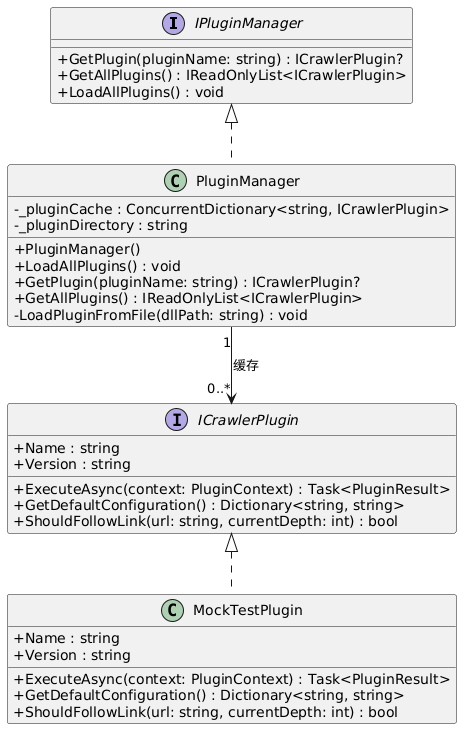

*图4-8 插件管理模块类图*

#### 4.1.3 通信协议详细设计

##### 4.1.3.1 gRPC协议定义

系统定义了CrawlerCoordinator核心服务，该服务包含两个RPC方法：

(1)RegisterNode：Worker节点注册接口，用于接收NodeRegistration消息，并返回RegistrationResponse消息

(2)StartStreaming：Master-Worker双向流式通信通道，用于接收FromWorker消息流，并返回FromMaster消息流

核心消息结构包括：

(1)NodeRegistration：节点注册请求消息，包含了node_id、machine_name、cpu_cores、total_memory_gb和ip_address等字段

(2)RegistrationResponse：节点注册响应消息，包含了success、session_id、message和system_config等字段

(3)Heartbeat：心跳上报消息，包含了node_id、cpu_usage、memory_usage_mb、disk_usage_percent、active_tasks和timestamp等字段

(4)CrawlerTask：爬虫任务消息，包含task_id、task_name、start_urls、plugin_name、configuration、max_depth、max_pages、status、priority等字段

(5)CrawlResult：爬取结果消息，包含task_id、page_results、completed_at等字段

(6)FromWorker：Worker向Master发送的消息统一封装体，通过oneof关键字区分heartbeat、log_entry、crawl_result、task_progress四种消息类型

(7)FromMaster：Master向Worker发送的消息统一封装体，通过oneof关键字区分new_task、task_control、system_config三种消息类型

gRPC核心消息结构表见表4-2。

**表4-2 gRPC核心消息结构表**

| 消息名称 | 关键字段 | 说明 |
|---|---|---|
| NodeRegistration | node_id, ip_address | 节点注册，提供身份和地址 |
| RegistrationResponse | success, session_id | 注册结果，分配会话 ID |
| Heartbeat | node_id, cpu_usage, active_tasks | 节点心跳，上报负载 |
| CrawlerTask | task_id, start_urls, status, priority | 爬虫任务定义与状态 |
| PageResult | url, status_code, parsed_data | 单页面爬取结果 |
| CrawlResult | task_id, page_results | 任务整体完成结果汇总 |
| TaskProgress | task_id, current_status, crawled_pages | 任务实时进度 |
| LogEntry | node_id, log_level, message | 结构化日志上报 |
| TaskControl | task_id, command | 主节点下发的任务控制指令 |
| SystemConfig | heartbeat_interval_seconds | 系统参数 |
| TaskStatus | Pending, Running, Completed, Failed | 任务状态枚举 |
| ControlCommand | Start, Pause, Stop, Cancel | 控制指令枚举 |

##### 4.1.3.2 双向流式通信实现

双向流式通信由Worker端（WorkerHostedService）和Master端（CrawlerCoordinatorService）协同实现，核心流程如下：

(1)流的建立

Worker端：节点注册成功后，触发OnNodeRegistered_StartStreamingAsync事件，调用StartStreamingAsync发起双向流连接。Worker端双向流实现类图见图4-9。

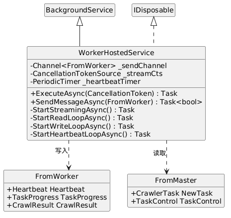

*图4-9 Worker 端双向流实现类图*

Master 端：通过CrawlerCoordinatorService.StartStreaming方法响应Worker的流请求，验证node-id和session-id后建立持久化通道。

Master端双向流实现类图见图4-10。

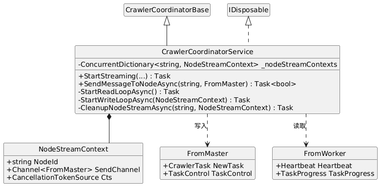

*图4-10 Master 端双向流实现类图*

(2)核心任务结构

Worker端的以下3个异步任务由StartStreamingAsync启动：

读循环（StartReadLoopAsync）：Master下发的消息（如NewTask、TaskControl和SystemConfig）会通过ResponseStream.ReadAllAsync()持续接收，然后会在switch分支中直接处理这些消息。

写循环（StartWriteLoopAsync）：从_sendChannel（Channel<FromWorker>）读取待发送消息，然后通过RequestStream.WriteAsync串行发送给Master，以避免并发写入异常。

心跳循环（StartHeartbeatLoopAsync）：按配置的时间间隔（GrpcSettings.HeartbeatIntervalSeconds）采集节点的心跳数据，然后通过SendMessageAsync写入到发送队列中。

(3)消息有序性与并发控制

采用System.Threading.Channels.Channel<T>实现无锁发送队列，配置SingleReader = true确保写循环单线程消费，保证消息有序性。

Master 端同理，通过Channel<FromMaster>解耦业务逻辑与流写入，避免直接并发调用IServerStreamWriter.WriteAsync。

(4)可靠性保障

重连机制：当Worker端的流断开后，通过HandleStreamReconnectAsync实现指数退避重连，当重连次数超过了最大重试次数后会触发重新注册流程。

资源清理：流、任务和定时器的生命周期由CancellationTokenSource联动控制， Channel关闭和资源释放由CleanupStreamResourcesAsync负责。

### 4.2 数据分析模块详细设计

#### 4.2.1 数据分析模块整体业务流程设计

该模块的主要业务流程可以分为四个依次执行的阶段，并且支持用户对参数进行回溯和调整，全流程的闭环如下：

(1)数据上传和预处理阶段：系统支持用户批量上传JSON格式的文献元数据，系统会自动对文件进行保存、解析JSON、提取主要字段、清洗文本和进行分词预处理，如果元数据格式符合要求，系统会生成并持久化存储标准化语料，同时更新数据处理状态。

(2)模型超参数配置和训练阶段：用户可以通过侧边栏对LDA模型的超参数进行配置，当用户触发训练操作后，系统会依据所配置的超参数来自动完成词典建立、语料库生成、LDA模型多核训练、评估指标计算和文献主题推理的工作，最终会生成包括主题标注的完整数据集，并且同步更新模型训练状态。

(3)可视化分析和筛选阶段：系统会自动进行多方面的可视化图表渲染，用户可以通过侧边栏按照主题、年份和主题置信度进行多条件组合筛选，筛选条件会实时联动所有可视化图表和数据视图，让用户不需要重复进行训练触发。

(4)数据导出阶段：用户可以选择导出全量的带主题标注的数据集，或者导出当前筛选视图下的数据集，系统将会自动生成UTF-8编码的CSV文件，以供用户下载到指定的位置。

数据分析核心业务流程图见图4-11。

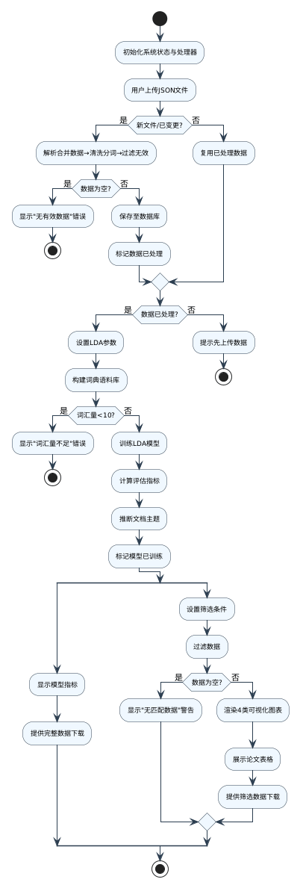

*图4-11 数据分析核心业务流程图*

#### 4.2.2 数据预处理模块详细设计

代码中的DataProcessor类实现了数据预处理模块，它是主题建模的前置基础，DataProcessor类的UML类图如图4-12所示。该模块的主要工作是对非结构化的文献元数据进行转换，使其成为标准化的可建模语料，并且可以分为3个主要子功能：

(1)JSON解析和字段提取子功能：该子功能可以兼容采集子模块的JSON输出格式，它会对pageResults节点下的parsedData字段进行递归解析，然后提取12项主要的文献元数据字段，并将其转换为结构化的DataFrame格式。本文对发表日期进行解析以获取年份字段，这些数据将支持后续的趋势分析工作。

(2)英文文本精细化预处理子功能：该子功能的主要流程包括：文本拼接，即把标题、摘要和学科分类进行结合，接着进行文本标准化，也就是把文本转换成小写并去除标点符号、数字及特殊字符，然后进行分词和词性标注，接着进行词性感知的词形还原，最后对停用词、短词、非字母字符进行过滤，最终生成标准化的token列表，并且把token长度少于2的无效数据过滤掉[27,36]。

(3)数据持久化子功能：该子功能的结构化文献数据存储在SQLite数据库中，对于Python列表类型中的tokens、authors_list和subjects_list字段，使用JSON字符串进行序列化存储，读取时会自动进行反序列化处理，从而达到数据的无损存储和快速读取的目的。

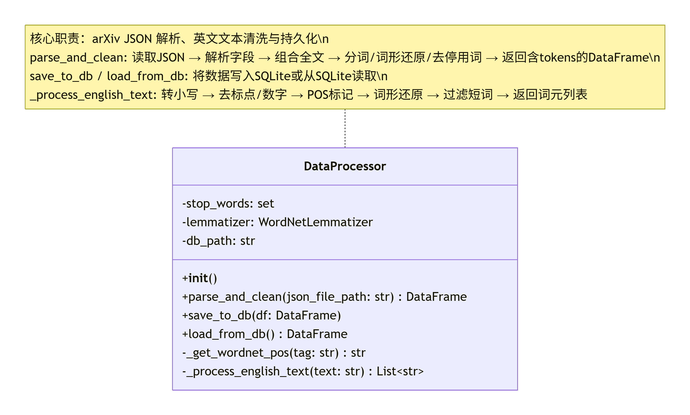

*图4-12 DataProcessor类UML类图*

#### 4.2.3 主题建模模块详细设计

主题建模模块通过代码里的TopicModeler类进行实现，属于子模块的算法中心，TopicModeler类的UML类图展示在图4-13中。该模块的主要职责是对LDA主题模型进行训练、对文献主题进行推理、生成主题标签，能够划分为3个主要子功能：

(1)词典和语料库建立子功能：该子功能把经过预处理的token列表当作基础，使用Gensim建立词典，把出现次数少于2、出现频率超过80%的极端词汇进行过滤，以此减少噪声给模型带来的干扰。本文使用词典将token列表转换成词袋模型BOW格式的语料库，模型训练因此获得了标准化的输入。

(2)LDA模型训练和评估子功能：该子功能使用了Gensim的LdaMulticore多核训练模式，同时也允许用户对主题数量、迭代次数、Alpha和Eta这些超参数进行自定义设置[11]。训练结束后会自动计算两个主要评估指标：对数困惑度，用来衡量模型的拟合效果，该数值越小越佳、CV主题一致性，用来衡量主题的可解释性，该数值在0到1之间，越大越好[25]。

(3)主题推理和标签生成子功能：该子功能以训练好的LDA模型为基础，对每篇文献进行全主题概率分布的推断，然后选取概率最高的主题作为主导主题，并且同步记录主题置信度。本文提取了各个主题的前N个关键词，并且生成可以说明主题的标签，这些标签会被用于后续的可视化展示。

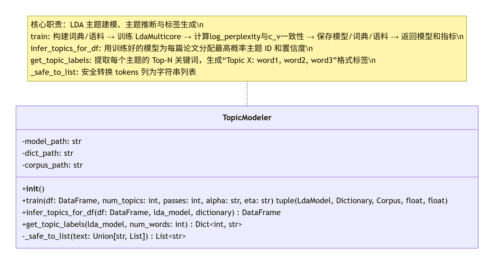

*图4-13 TopicModeler类UML类图*

#### 4.2.4 可视化渲染模块详细设计

可视化渲染模块由代码中的Visualizer类实现，用于展示子模块的结果，Visualizer类的UML类图见图4-14。该模块的核心职责是将主题建模的结果转换为可交互的可视化图表[13-14]。可以分成5个核心子功能：

(1)主题分布柱状图渲染：统计每个主题的文献数量，采用Plotly生成交互式的柱状图，该柱状图可以支持鼠标悬停来查看详细数值，以便直观地展示各主题的文献分布情况。

(2)主题词云渲染：系统会提取指定主题的前30个关键词，然后按照词频生成词云图，这样能够直观地展示主题的主要语义特点，并且让用户自由地查看不同主题。

(3)主题年度趋势折线图渲染：本文按照年份和主题对文献数量进行分组统计，通过Plotly生成交互式折线图，该折线图展示了不同研究主题随年份的变化趋势，可以用来发现学术研究热点的变化规律。

(4)主题间距离映射图渲染：本文利用pyLDAvis生成交互式主题距离图，并且通过PCA降维来展示主题之间的相似度和区分度，这样做可以同步显示主题的词汇分布，同时也支持用户进行交互式探索主题之间的关联关系。

(5)数据表格渲染：系统通过表格形式把筛选后的文献数据进行展示，并且可以按照主题置信度进行排序，arxiv_id字段会自动转换成能够跳转的超链接，这样便于用户查看原始文献。

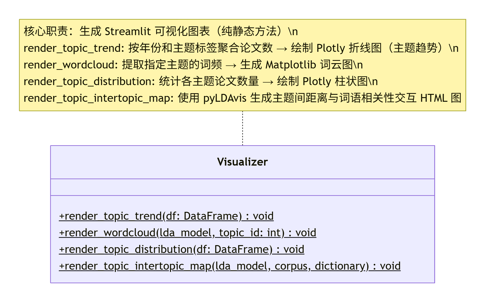

*图4-14 Visualizer类UML类图*

#### 4.2.5 交互层与会话状态管理详细设计

交互层基于Streamlit框架实现，核心解决Web页面刷新后状态丢失的问题，通过st.session_state实现全局会话状态管理，预定义14个会话状态变量，分为3大类：

(1)数据状态变量：包括processor、modeler类实例，df_raw原始数据集，data_processed数据处理状态，last_uploaded上传文件记录；

(2)模型状态变量：包括model_trained模型训练状态，df带主题标注的数据集，lda_model模型文件，dictionary词典，corpus语料库，topic_labels主题标签和perplexity、coherence评估指标；

(3)筛选状态变量：包括了用户选择的主题、年份范围和最小置信度，会用于可视化视图的实时筛选。

会话状态由setdefault方法初始化，可以保证在页面刷新后状态不会丢失；当用户上传新文件和重新训练模型时，会自动重置对应状态的变量，以避免数据错乱。

### 4.3 小结

本文依据系统整体架构规划，完成了两个主要模块的设计工作。在分布式爬虫管理模块中，该模块实现了Master控制端的节点管理、任务调度、故障恢复和数据持久化等主要模块的类结构、状态流转和业务流程设计，并且明确了Worker节点的爬虫执行引擎、资源监控器、会话管理和插件管理四个主要组件的实现逻辑，同时规范了gRPC通信协议的消息结构和双向流式通信的全流程实现方式。本文对数据分析模块进行了改进，实现了数据上传到模型训练再到可视化分析最后到数据导出的完整业务流程。该模块细化了数据预处理、主题建模和可视化渲染这三个主要模块的类结构和功能逻辑，还设计了依靠会话状态管理来实现交互层的方法。本章完成了系统从架构设计到可开发实现的技术实现，是系统编码开发的完整且规范的技术基础。

## 第5章 关键技术实现

### 5.1 分布式爬虫管理模块关键技术实现

#### 5.1.1 资源感知的负载均衡调度算法

系统采用资源感知的负载均衡调度算法，根据节点的实时资源使用情况和任务特性计算节点得分，选择得分最高的节点执行任务。算法核心思想是将任务分配到负载最低、最适合执行该任务的节点，提高集群资源利用率和任务执行效率[31]。负载均衡调度算法流程图见图5-1。

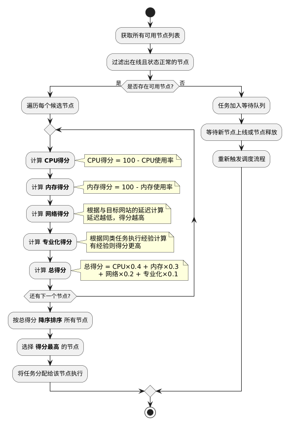

*图5-1 负载均衡调度算法流程图*

节点评分公式见式5-1：

节点得分 =  CPU得分 × 0.4 + 内存得分 × 0.3 +

网络得分 × 0.2 + 专业化得分 × 0.1       (5-1)

公式中各评分项的权重配置、计算规则与业务含义详见表5-1。

**表5-1 评分详情表**

| 评分项 | 权重 | 计算公式 | 说明 |
|---|---|---|---|
| CPU得分 | 0.4 | 100 - CPU使用率 | 反映节点的CPU可用资源，使用率越低，得分越高 |
| 内存得分 | 0.3 | 100 - 内存使用率 | 反映节点的内存可用资源，使用率越低，得分越高 |
| 网络得分 | 0.2 | 根据网络延迟映射计算 | 基于节点与目标网站的网络延迟，延迟越低得分越高 |
| 专业化得分 | 0.1 | 根据同类任务经验标记计算 | 有同类任务执行经验的节点得分更高 |

算法实现于LoadBalancingScheduler类的SelectOptimalNode方法。方法首先过滤出所有在线的可用节点，然后为每个节点计算得分，最后选择得分最高的节点执行任务。如果没有可用节点，任务将留在队列中等待，直到有节点可用。

#### 5.1.2 高可靠双向流式通信机制

系统采用了gRPC双向流式通信实现Master和Worker之间的实时通信，通信的可靠性有多种机制保证[43-44]。

消息有序性保证：系统使用System.Threading.Channels.Channel<T>来建立高性能的异步无锁队列，所有待发送消息都先写入Channel，然后由单线程统一读取并写入gRPC流，也就是Master端StartWriteLoopAsync和Worker端StartWriteLoopAsync，这样可以防止并发写入造成流帧交错异常。Channel也支持多生产者单消费者MPSC模式，该模式适合用来解耦业务逻辑和网络传输，并且确保消息具有严格的有序性。

关键环节超时控制：系统对于核心流程实现了超时控制：

(1)节点注册RPC调用：设置了10秒Deadline（ExecuteRegistrationWithRetryAsync）；

(2)流关闭清理方式：系统需要等待发送队列内的所有消息都消费完之后再进行关闭操作，对应的超时阈值由GrpcConstants.DefaultStreamCloseTimeoutMs参数来控制。

(3)重连总耗时：本文主要通过计算最大重试次数MaxRetryAttempts和固定延迟RetryDelayMilliseconds的乘积，来进行间接控制。

断连重连和重新注册方式：系统会对流状态进行实时监测，包括读写循环异常退出、CancellationToken触发的情况，当流出现异常断开时，系统会按照下面的流程自动进行恢复：

(1)Disconnected：流断开后，系统会进入该状态，并且立即对旧的流资源进行清理。

(2)Reconnecting：系统先对重试计数器进行递加处理，在等待预设的固定时长延迟之后，重新建立gRPC通道并且发起重连请求。

(3)Connected：表示重连成功，接着重置重试计数器，使系统恢复正常通信。

(4)Registering：如果重试的次数多于MaxRetryAttempts，那么系统会清空旧Session，并且重新进行节点注册流程，等到重新注册成功后，系统就会回到Connected状态。

断线重连状态机见图5-2。

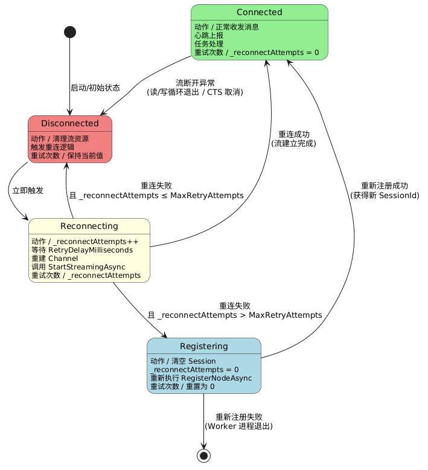

*图5-2 断线重连状态机*

该方式可以保证网络波动后进行自动恢复，并且利用固定延迟来防止频繁重连给Master带来压力。

#### 5.1.3 实时数据同步与可视化技术

系统基于ASP.NET Core SignalR实现了实时数据同步功能，基于OxyPlot.Wpf实现了实时数据可视化功能。

(1)SignalR集成：系统的SignalR服务被托管在ASP.NET Core通用主机中，并配置了独立的端口（默认5003），以避免与gRPC端口（默认5001）发生冲突。系统实现了强类型Hub客户端，以提高代码的可维护性。通过SignalR Hub将节点状态和任务进度推送到所有连接的UI客户端以实现Master控制端的实时数据同步服务。

(2)数据节流：系统对数据更新做了节流处理，以避免高频更新所导致的UI卡顿和网络拥塞。为确保在指定时间间隔内只发送一次更新，通过ConcurrentDictionary+DateTime时间差判断来实现节流机制。

(3)实时图表实现：为了展示节点资源使用情况和任务执行进度，系统基于OxyPlot.Wpf实现实时的折线图和柱状图。并且采用了增量更新的方式，通过只更新变化的数据点，以减少UI渲染的开销。同时图表也支持缩放和拖拽操作，可以方便用户查看详细数据。

#### 5.1.4 系统数据库性能优化策略

为了提高数据访问的性能，系统采用了多种数据库优化策略：

索引优化策略：本文为CrawlerTask任务表的AssignedNode和Status这两个字段分别建立二级索引，这样做可以减少任务筛选时的查询成本，并且使数据检索速度得到明显提高。

数据约束：对字符串的长度进行限制，例如Url长度为2048字符，用来减少存储空间的占用。

数据库方面设有CreatedAt等默认值，通过IsRequired()来保证必填字段非空。

变更跟踪：通过自定义JSON集合中的ValueComparer，来防止不必要的更新。

关系配置：CrawlResult和PageResult进行级联删除，能够防止出现孤儿记录的情况。

主键明确：显式定义主键，部分字段设置自增属性。

#### 5.1.5 高可用机制实现

系统实现了多种高可用机制，确保在节点故障的情况下仍能正常运行：

节点故障检测：Master端的NodeHealthCheckService后台服务定期执行一次健康检查，将超过配置时长无心跳的节点标记为离线。健康检查采用独立的DI作用域，避免与其他业务逻辑冲突。

任务重新分配：当节点被标记为离线时，系统自动将该节点上的所有未完成任务重新加入调度队列。任务调度器将这些任务分配给其他可用节点，确保任务能够继续执行。

节点故障处理流程图见图5-3。

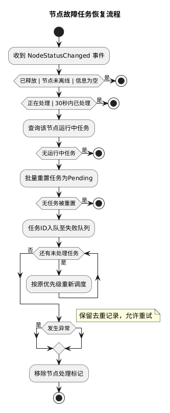

*图5-3 节点故障处理流程图*

### 5.2 数据分析模块关键技术实现

#### 5.2.1 面向学术文献的英文文本精细化预处理技术

(1)词性感知的词形还原技术：传统词形还原默认按名词处理，容易导致动词和形容词的错误还原。本模块为了针对性实现精准词形还原，基于POS标签构建了WordNet词性映射规则，将词性分成形容词、动词、名词和副词四类 [36]。

(2)多字段文本融合技术：本模块将标题、摘要和学科分类三个字段融合成完整的分析文本，最大化利用文献的语义信息，解决了部分文献摘要信息缺失（仅为URL）的问题，并有效地解决了短文本的主题建模效果差的问题。

(3)NLTK资源静默初始化技术：当Streamlit部署时，NLTK资源下载会弹出系统弹窗，这会严重影响用户的体验。为了完全避免弹窗的问题，提升跨平台部署的兼容性，本模块通过自定义NLTK_DATA环境变量，提前检测资源是否存在，如果有缺失则采用静默模式下载。

#### 5.2.2 可配置化LDA主题模型训练与鲁棒性推理技术

(1)多核并行训练优化：本文使用Gensim的LdaMulticore多核训练模式，该模式可以进行多线程并行计算，和单线程训练相比，多线程会缩短用户等待时间。

(2)全超参数可视化配置：利用侧边栏上的滑块和下拉框进行可视化配置，把主题数量、迭代次数、Alpha和Eta这些主要超参数全部开放，并且给出推荐的默认值，这样可以同时满足专业用户对调优的要求和普通用户对易用性的要求。

(3)鲁棒性主题推理方式：本文对每篇文献计算了全主题的概率分布，并且选取概率最高的主题作为主导主题，同时记录主题置信度，用户可以调整置信度阈值来过滤低质量的推理结果，解决了短文本和低信息量文献的主题推理结果不稳定问题，提高主题分类的准确率。

(4)模型和数据持久化方案：为了让用户在刷新页面后不用重新训练模型，该模块训练完成的模型、词典和语料库会自动保存到本地文件系统中，同时带有主题标注的数据集也会保存到SQLite数据库，这改善了用户的使用体验。

#### 5.2.3 基于Streamlit的低代码交互式可视化联动技术

(1)全局会话状态管理方式：本模块使用st.session_state进行全局会话状态管理，把类实例、处理状态和模型结果都存入会话状态，解决了Streamlit页面刷新后变量重置的问题，保证页面刷新后状态不丢失，实现了多步骤的线性业务流程。

(2)多方面筛选和可视化实时联动：系统把筛选条件和全部可视化图表进行了实时联动。用户在修改主题、年份和置信度筛选条件后，不用点击确认按钮，就可以实时更新所有图表和数据表格，进而提高学术分析的流畅性。

(3)pyLDAvis可视化无缝嵌入：该模块利用st.components.v1.html组件把pyLDAvis生成的HTML格式主题距离图顺利嵌入到Streamlit中，并且对宽度和高度进行了设置，还添加了滚动条，这样处理后就解决了pyLDAvis生成的HTML格式主题距离图不能直接嵌入Streamlit的问题，可以达到和原生组件相同的交互体验。

#### 5.2.4 主题数量选择与模型评估

在LDA主题建模中，选择的主题数量K会影响模型的可解释性、下游分析的质量[24]。本文运用对数困惑度Log Perplexity和主题一致性CV Coherence这两个常用指标来完成定量评估工作，目的是找到适合本系统的最优K值，并且分析不同的K值给模型性能带来的影响[25]。其中对数困惑度用来衡量模型对未参与训练的语料进行预测的能力，数值越低表示模型的泛化性能越好。主题一致性用来反映主题中高权重词在参考语料里的共现情况，该指标是通过滑动窗口和间接确认度量indirect confirmation measure来计算的，得分越高说明主题在语义上越连贯。

实验设置使用了arXiv论文数据集中1000份元数据，通过Gensim的LdaMulticore来完成，将其他超参数固定为：训练轮数passes设为10，文档与主题的先验为对称形式，主题和词的先验也为对称形式。在6到10这个范围内，本文先使用80%的数据进行训练，把剩下的20%当作留出集来进行对数困惑度的计算。本文使用全部训练语料，通过CoherenceModel，参数window_size等于50，来计算主题一致性。为减少随机初始化造成的影响，在进行每组实验时重复进行3次并取平均值后进行记录。

实验结果表5-2说明了在不同主题数下，对数困惑度和主题一致性发生的变化趋势。在有限范围内，K增大，对数困惑度表现出单调降低的趋势，说明主题数量增多，模型拟合数据的能力也会随之提高。而主题一致性表现为先上升后下降的趋势，当K的数值较小时，主题比较宽泛，语义的颗粒度不够。K的数值较大时，部分主题会表现出碎片化或者过拟合的情况，这种情况会使主题的一致性降低。在该实验中，当K取9时，主题一致性达到最高值CV为0.43，并且对数困惑度Log Perplexity等于负7.1的数值也在合理范围内，这说明本系统的模型在当前配置下，在复杂度和语义凝聚性之间达到了较好的平衡。

因此，本文的分析中的正式模型的主题数选为K=9。

**表5-2 实验结果**

| Number of Topics (K) | 主题一致性（Coherence Score） | 对数困惑度（Log Perplexity） |
|---|---|---|
| 6 | 0.38 | -7.0 |
| 7 | 0.39 | -7.1 |
| 8 | 0.41 | -7.1 |
| 9 | 0.43 | -7.1 |
| 10 | 0.38 | -7.2 |

### 5.3 小结

本章对于系统设计和实现中的核心技术难点，进行了关键技术的落地实现、优化和验证。在分布式爬虫管理模块，为解决分布式环境下任务调度不均、通信可靠性不足和节点故障自愈难度高等核心问题，实现了资源感知的负载均衡调度算法、高可靠gRPC双向流式通信机制、实时数据同步与可视化技术和数据库性能优化策略，以及节点故障自动检测和任务转移的高可用机制；在数据分析模块，为解决了学术文本语义挖掘精度不足、模型可解释性差和多图表联动卡顿等关键问题，实现了面向学术文献的英文文本精细化预处理技术、可配置化LDA主题模型训练和鲁棒性推理技术和基于Streamlit的低代码交互式可视化联动技术，并且为了找到适配于本系统数据集的最优主题数进行了对照实验。本章的技术实现和优化，支撑了系统核心功能的落地，能够保障系统运行的性能、稳定性和可用性。

## 第6章 系统部署与验证

### 6.1 分布式爬虫管理模块部署与验证

#### 6.1.1 Docker容器化部署

为了提升系统部署效率，在生产环境中选用Docker多阶段构建技术来搭建服务镜像，这能够有效地压缩镜像体积，并隔离运行环境依赖[46]。系统结合Docker Compose实现了分布式节点集群部署，支持Worker节点的多副本配置和故障自动重启，同时独立的容器网络也能为服务间提供稳定的通信[47]。系统使用环境变量和配置文件挂载相结合的方式，以灵活配置服务通信地址、运行模式和节点认证信息，这满足了生产环境下分布式集群的运维管理和横向扩展需求。图6-1为Docker部署架构图，该图展示了容器集群网络拓扑、服务通信端口和配置挂载结构。

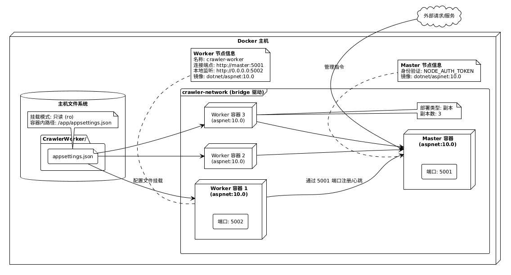

*图6-1 Docker部署架构图*

#### 6.1.2 系统配置说明

配置文件负责管理系统的主要运行参数，并且允许用户根据运行负载和应用场景进行相应调整，参数主要包括gRPC通信、爬虫运行、数据存储和实时监控等主要模块。节点通信地址、心跳周期和数据传输上限通过gRPC配置来进行管理，该配置可以让分布式节点进行稳定的交互。爬虫利用配置来对访问标识、请求超时、任务间隔和并发上限进行管理，能够对爬虫的运行策略进行控制，进而使网络访问风险得到减少。数据配置包括了轻量化的数据持久化参数，监控模块通过配置来进行节点状态和任务进度的实时更新。表6-1汇总了系统主要配置项、默认参数和功能说明，作为系统运行配置和后期维护的参考依据。

**表6-1 核心配置项说明表**

| 配置项 | 默认值 | 说明 |
|---|---|---|
| GrpcSettings:MasterEndpoint | http://0.0.0.0:5001 | Master gRPC服务地址（监听/连接） |
| GrpcSettings:NodeAuthToken | test-token | 节点间通信认证令牌，所有节点须一致 |
| GrpcSettings:HeartbeatIntervalSeconds | 5 | Worker向Master发送心跳的时间间隔（秒） |
| CrawlerSettings:MaxConcurrentRequests | 10 | 单个爬取任务的最大并发HTTP请求数 |
| CrawlerSettings:DelayBetweenRequestsMs | 1000 | 相邻请求的固定间隔（毫秒），控制请求速率 |
| CrawlerSettings:MaxConcurrentTasks | 2 | Worker同时执行的最大任务数 |
| ConnectionStrings:ConnectionString | Data Source=crawler.db | 数据库连接字符串（SQLite，Master用于元数据存储） |
| SignalRSettings:Port | 5003 | SignalR Hub监听端口，用于实时推送节点和任务状态 |
| Logging:LogLevel:Default | Debug | 应用程序全局最低日志级别 |

#### 6.1.3 系统功能验证

本文对分布式爬虫的主要运行模块进行了单元测试，以此来验证系统设计的合理性、功能的完整性。单元测试包括了节点管理、任务调度、实时监控、插件扩展和故障恢复等主要功能。本文编写和测试通过了104个针对不同场景的单元测试。

测试结果表明，系统节点可以进行自动注册和离线识别，爬虫任务可以依据负载情况把任务分配到指定的Worker节点上。模块化插件模式可以稳定运行，它支持加载外部插件和独立运行，并且可以满足多类型的爬虫业务扩展需求。系统可以检测到节点发生异常中断时所出现的故障节点，并且自动把未完成的任务调度到正常节点，以保证爬虫业务能够连续运行。整体的各项主要功能可以稳定运行，系统设计要求已经得到满足，并且可以满足分布式爬虫运行的各功能需求。

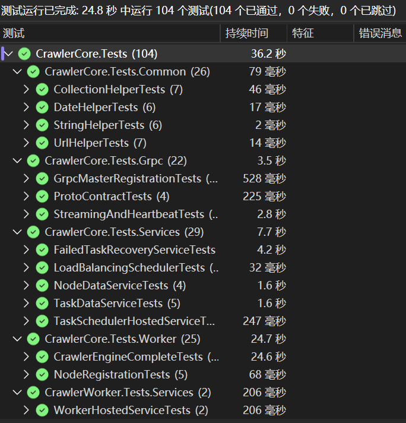

*图6-2 展示了所有子模块的单元测试项目和结果。*


*图6-2 单元测试项目和结果*

#### 6.1.4 资源占用测试

测试持续监测在不同并发任务负载条件下的Master与Worker节点的CPU和内存等资源的占用情况。测试结果表明，系统的资源消耗和运行负载变化趋势平稳，在常规运行状态下的资源占用量在合理区间中，服务运行轻量化。主控节点和爬虫节点的资源消耗可控，运行的稳定性强，能够满足稳定长期运行的需求。

#### 6.1.5 系统可用性测试

本文利用进行节点故障模拟测试的方式，多次模拟Worker节点发生异常中断的场景，以验证分布式系统的容错能力和运行稳定性，并检测系统故障识别、任务调度和恢复能力。根据多次测试结果，该系统可以在规定时间内识别出异常节点，并且迅速把未完成的任务重新分配，拥有完整的故障检测方式，保证任务执行拥有稳定的成功率。系统在生产环境中达到了高稳定和高可靠的要求，容错机制比较完善，能够迅速对突发的节点故障做出响应，拥有不错的自愈能力，可以对分布式运行过程中的各种异常问题进行有效处理。

### 6.2 数据分析模块的验证

#### 6.2.1 模块功能验证

采用黑盒测试方法，针对模块核心功能设计测试用例，测试结果如表6-2所示。

**表6-2 核心功能测试用例**

| 测试功能 | 测试步骤 | 测试结果 |
|---|---|---|
| 数据上传与预处理 | 批量上传100个JSON文件 | 1. 文件成功保存；2. 成功解析生成结构化数据集；3. 侧边栏提示处理成功，显示总论文数量 |
| LDA模型训练 | 配置主题数 8、迭代次数10、默认先验参数 | 1. 模型成功训练；2.生成困惑度、一致性评估指标；3. 为所有论文匹配主题与置信度；4.提示训练成功 |
| 超参数配置生效 | 分别配置主题数2/10/15、迭代次数5/20/30 | 模型按配置参数完成训练，生成对应主题数量与评估指标，所有参数配置生效 |
| 可视化分析 | 1.完成模型训练；2.查看所有可视化图表 | 所有图表正常渲染无报错 |
| 数据导出 | 1.下载全量数据集；2.下载当前视图数据集 | 1.成功生成CSV文件并下载；2.文件无乱码，数据字段完整，与系统展示一致 |

#### 6.2.2 模块性能验证

针对非功能性需求中的性能要求，设计多场景性能测试，测试结果如表6-3所示。

**表6-3 性能测试**

| 测试场景 | 期望结果 | 实测结果 | 是否达标 |
|---|---|---|---|
| 100条文献数据预处理 | <=15s | 10.38s | 是 |
| 1000条文献数据预处理 | <=15s | 13.48s | 是 |
| 100条文献数据、主题数5、迭代次数10的模型训练 | <=100s | 73.30s | 是 |
| 100条文献数据主题数10、迭代次数20的模型训练 | <=100s | 78.53s | 是 |

### 6.3 小结

本章对分布式爬虫管理模块的容器化部署方案进行了设计，并且对其在功能、性能和可用性上的各方面表现进行了测试验证。就分布式爬虫管理模块而言，本文设计了利用Docker和Docker Compose来进行容器化集群部署的方法，并且制定系统中心运行参数的配置标准。该模块利用104个单元测试用例进行测试，以完成对主要功能的验证工作。本文也进行了资源占用测试和节点故障模拟测试，以验证系统的轻量化特点和高可用性。在数据分析模块中，为了检验系统各个性能指标都能达到设计要求，设计了黑盒测试来完成数据上传、模型训练、可视化分析和数据导出这些核心功能的验证工作，并且进行了多梯度的性能测试。本章的测试结果表明该系统可以稳定地进行学术文献元数据采集和主题可视化分析的全部业务流程，系统设计的合理性、功能实现的完整性、运行的稳定性都达到要求。该系统实现了预定的研究和设计目的。

## 第7章 结束语

本文设计并实现了一套拥有分布式元数据采集和主题可视化分析功能的学术文献分析系统，用来解决在海量学术文献产出情况下，传统文献检索和分析工具难以满足科研人员对宏观学科洞察需求的问题。系统的主要设计采用低耦合模块化的方式，可以拆分成分布式爬虫管理和数据分析这两个独立模块，这些模块通过标准的JSON格式进行数据传递。该系统处理了学术文献数据采集困难、整合困难、高门槛深度分析和可视化呈现较弱的问题。

本文主要工作和收获包括两个方面：第一，分布式爬虫模块使用Master-Worker主从架构，形成资源感知的负载均衡调度方法、高可靠的gRPC双向流式通信方式和节点故障自动转移模式，并且通过插件化架构实现能够灵活扩展数据源的系统，经过多场景测试验证，系统的多节点并行采集任务可以稳定支持，具有高可用性和可扩展性。第二，数据分析模块建立了精细化的预处理流水线来规范地处理英文学术文献，并且实现了可配置的LDA主题建模、全流程交互式的可视化分析，可以帮科研人员降低文献分析的难度，给学科研究热点识别和主题演化规律挖掘提供了量化的数据支持。

本文仍然存在一些局限性，当前的系统主题建模只使用了LDA模型，在超大规模语料情况下，细粒度语义挖掘能力比较有限。爬虫模块因为没有集成IP代理池或者验证码识别这些反爬应对方式，所以很难适配部分受到限制的学术数据源。两个模块之间仍然进行文件级对接，流程联动水平没有达到端到端自动化水平。后续研究会把预训练语言模型应用到主题挖掘中，以提高其效果，同时加入反爬适配功能来扩大数据源的覆盖范围，让采集和分析模块能够建立实时的数据链路，另外为了进一步完善系统的学术洞察能力，增加了作者合作网络和机构科研影响力评估等分析方面，给科研工作者提供更加整体和高效的文献分析工具。

## 参考文献

[1] DANELL R. Global shifts in scientific production: the decline of academic freedom and the impact on international collaboration[J]. European Review, 2025, 33(Suppl): S161-S175.

[2] 中国科学技术信息研究所. 2023年中国科技论文统计报告[R]. 北京: 中国科学技术信息研究所, 2023.

[3] 邱均平. 文献计量学[M]. 第2版. 北京: 科学出版社, 2019.

[4] 赵星, 乔利利, 叶鹰. 面向数据智能和知识发现的图书情报学跨界拓展——数据—学术—创造整合论[J]. 中国图书馆学报, 2020, 46(6): 20-34.

[5] 张晓林. Library-Inside: AI赋能图书馆新质生产力的一种基础模型[J]. 中国图书馆学报, 2024, 50(3): 4-16.

[6] 刘小慧, 朱曼曼. 科研论文颠覆性与参考文献年龄之间的关系研究[J]. 情报理论与实践, 2023, 46(7): 60-66. DOI: 10.16353/j.cnki.1000-7490.2023.07.008.

[7] 程秀峰, 邹晶晶, 叶光辉, 等. 融合Word2Vec的半积累引用共词网络的领域主题演化研究[J]. 情报学报, 2023, 42(6): 577-588. DOI: 10.3772/j.issn.1000-0135.2023.07.004.

[8] 张军, 魏继桢, 李钰彬. 基于资源感知的分布式爬虫任务调度方法[J]. 现代电子技术, 2024, 47(9): 86-90.

[9] 杨镇雄, 蔡祖锐, 陈国华, 等. 分布式开放存取期刊爬虫的设计与实现[J]. 计算机科学与探索, 2014, 8(10): 1187-1194. DOI: 10.3778/j.issn.1673-9418.1405051.

[10] BLEI D M, NG A Y, JORDAN M I. Latent Dirichlet allocation[J]. Journal of Machine Learning Research, 2003, 3: 993-1022.

[11] 胡泽文, 韩雅蓉, 王梦雅. 基于LDA-Word2vec的图书情报领域机器学习研究主题演化与热点主题识别[J]. 现代情报, 2024, 44(4): 154-167.

[12] 陈敬雷. 自然语言处理原理与实战[M]. 北京: 清华大学出版社, 2023.

[13] 孙佳佳, 李雅静. 基于关键词价值细分的高价值热点主题识别方法研究[J]. 情报学报, 2022, 41(2): 118-129.

[14] 陈为, 沈则潜, 陶煜波, 等. 数据可视化（纪念版）[M]. 第3版. 北京: 电子工业出版社, 2023.

[15] 范丽鹏, 焦玉莹, 王曰芬. 知识内容新颖性度量方法对比分析研究[J]. 图书情报工作, 2025, 69(20): 39-51.

[16] PUENTE J H, LUCERO-BALDEVENITES E V, DÍAZ-CHIENG L Y, et al. Tools and methodologies for scientific evaluation: bibliometrics, scientometrics and informatics[J]. Seminars in Medical Writing and Education, 2024, 3: 395. DOI: 10.56294/mw2024395.

[17] KUSA W, MENDOZA O E, SAMWALD M, et al. CSMeD: bridging the dataset gap in automated citation screening for systematic literature reviews[C]//Advances in Neural Information Processing Systems 36 (NeurIPS 2023) Datasets and Benchmarks Track. New Orleans, LA, USA: NeurIPS, 2023: 1-18.

[18] 严嘉欢, 钱书豪, 王宇婷, 等. 我国网络爬虫技术的数据合规法律风险及其完善建议——以我国网络爬虫511个案例的实证分析为出发点[C]//上海法学研究(集刊). 上海: 上海市法学会, 2023: 231-242.

[19] 刘若宇, 刘晓燕. 一种组合优化模型驱动的微服务拆分方法[J]. 小型微型计算机系统, 2023, 44(12): 2812-2818.

[20] 向清平, 燕钰, 程思佳, 等. 分布式数据库高可用研究进展[J]. 软件学报, 2026, 37(1): 259-278.

[21] 潘路, 罗涛, 牛新征. 基于分布式集群节点的宕机重启恢复算法[J]. 计算机科学, 2023, 50(6A): 220300205-220300206. DOI: 10.11896/jsjkx.220300205.

[22] SIWIK L, WŁODARCZYK K, KLUCZNY M. Staged event-driven architecture as a micro-architecture of distributed and pluginable crawling platform[J]. Computer Science, 2013, 14(4): 645-666.

[23] 高钰, 王栋, 戴千旺, 等. 共用数据导向的分布式系统失效恢复缺陷检测[J]. 软件学报, 2023, 34(12): 5578-5596.

[24] KOLTCOV S, SURKOV A, FILIPPOV V, et al. Topic models with elements of neural networks: investigation of stability, coherence, and determining the optimal number of topics[J]. PeerJ Computer Science, 2024, 10: e1758.

[25] RÖDER M, BOTH A, HINNEBURG A. Exploring the space of topic coherence measures[C]//Proceedings of the 8th ACM International Conference on Web Search and Data Mining. Shanghai: ACM, 2015: 399-408.

[26] PRABHA S, SARDANA N. Optimizing latent Dirichlet allocation using metaheuristic technique: a comparative study[J]. International Journal of Performability Engineering, 2025, 21(3): 131-140.

[27] SIINO M, TINNIRELLO I, LA CASCIA M. Is text preprocessing still worth the time? A comparative survey on the influence of popular preprocessing methods on Transformers and traditional classifiers[J]. Information Systems, 2024, 121: 102342.

[28] DANG T, NGUYEN H N, PHAM V. WordStream: interactive visualization for topic evolution[C]//EuroVis 2019 - Short Papers. Porto, Portugal: The Eurographics Association, 2019: 103-107. DOI: 10.2312/evs.20191178.

[29] RICHARDS T. Streamlit for data science: create interactive data apps in Python[M]. 2nd ed. Birmingham: Packt Publishing, 2023.

[30] TALERO-SARMIENTO L, LAMOS-DÍAZ H, MÁRQUEZ GONZÁLEZ J D. ViDoe: a novel tool for visualizing design of experiments[C]//Proceedings of the 11th International Conference on Innovation, Documentation and Teaching Technologies (INNODOCT 2023). Bucaramanga, Colombia: Editorial Universitat Politècnica de València, 2023: 88-95.

[31] WANG X, CHEN Z, KONG M, et al. A hunger-based scheduling strategy for distributed crawler[J]. Expert Systems with Applications, 2023, 222: 119798.

[32] GIANNOULA C, STRATI F, SIAKAVARAS D, et al. SmartPQ: an adaptive concurrent priority queue for NUMA architectures[EB/OL]. (2024-06-11)[2026-05-04]. https://arxiv.org/abs/2406.06900. DOI: 10.48550/arXiv.2406.06900.

[33] GE D J, DING Z J, JI H F, et al. A task scheduling strategy based on weighted round-robin for distributed crawler[J]. Concurrency and Computation: Practice and Experience, 2016, 28(11): 3202-3212. DOI: 10.1002/cpe.3701.

[34] 贾统, 李影, 吴中海, 等. 基于日志数据的分布式软件系统故障诊断综述[J]. 软件学报, 2020, 31(7): 1997-2018.

[35] ACHER M, CLEVE A, COLLET P, et al. Extraction and evolution of architectural variability models in plugin-based systems[J]. Software and Systems Modeling, 2014, 13(4): 1367-1394.

[36] 杨肖, 肖蓉. 文档级关系抽取中的小波变换特征增强方法[J]. 中文信息学报, 2024, 38(2): 109-120, 131.

[37] 张勇, 王博岳, 胡永利. 可视化数据分析[M]. 北京: 中国铁道出版社有限公司, 2024.

[38] MAJEED A. Attribute-centric and synthetic data based privacy preserving methods: a systematic review[J]. Journal of Cybersecurity and Privacy, 2023, 3(3): 638-661.

[39] 王思乐, 石强, 罗文劼. 数据结构与算法：Java版[M]. 第2版. 北京: 机械工业出版社, 2024.

[40] 李代平, 杨成义. 软件工程[M]. 第4版. 北京: 清华大学出版社, 2017.

[41] 罗伯特·C·马丁. 架构整洁之道[M]. 孙宇聪, 译. 北京: 电子工业出版社, 2018.

[42] 刘铁猛. 深入浅出WPF[M]. 北京: 中国水利水电出版社, 2010.

[43] GENG L, WANG H, MENG J, et al. RR-Compound: RDMA-fused gRPC for low latency, high throughput, and easy interface[J]. IEEE Transactions on Parallel and Distributed Systems, 2024, 35(8): 1488-1505.

[44] JARMOSZEWICZ J, IWANOWSKI P, PLECHAWSKA-WÓJCIK M. Analysis of the performance and scalability of microservices depending on the communication technology[J]. Journal of Computer Sciences Institute, 2024, 33: 323-330.

[45] 李群, 袁津生. 搜索引擎技术与应用开发[M]. 北京: 清华大学出版社, 2020: 42-65.

[46] 杨保华, 戴王剑, 曹亚仑. Docker技术入门与实战[M]. 第4版. 北京: 机械工业出版社, 2025.

[47] 李萌, 王健, 刘畅. 基于Docker容器的分布式爬虫的设计与实现[J]. 电子设计工程, 2020, 28(8): 61-65.

## 附录

```text
DistributedCrawler/
├── CrawlerMaster.WPF/          # Master控制端
│   ├── Converters/
│   │   ├── BooleanToVisibilityConverter.cs
│   │   ├── GreaterThanConverter.cs
│   │   ├── NullToDashConverter.cs
│   │   ├── NullToVisibilityConverter.cs
│   │   ├── RelativeTimeConverter.cs
│   │   └── UtcToLocalTimeConverter.cs
│   ├── Data/
│   │   └── CrawlerDbContext.cs # 数据库上下文类
│   ├── Infrastructure/
│   │   └── GrpcAuthenticationInterceptor.cs # gRPC 认证拦截器
│   ├── Models/                  # 数据模型
│   │   ├── NodeUpdateMessage.cs # 节点状态实时推送消息
│   │   └── TaskProgressMessage.cs # 任务进度实时推送消息
│   ├── Services/               # 业务服务
│   │   ├── Hubs/
│   │   │   ├ CrawlerHub.cs     # 爬虫实时通信Hub
│   │   │   └ ICrawlerHubClient.cs # 爬虫Hub客户端接口
│   │   ├── CrawlerCoordinatorService.cs # gRPC协调服务实现
│   │   ├── FailedTaskRecoveryService.cs # 故障任务恢复服务
│   │   ├── GrpcHostedService.cs # gRPC托管服务类
│   │   ├── ICrawlerCoordinatorService.cs # gRPC协调服务接口
│   │   ├── ILoadBalancingScheduler.cs # 资源感知负载均衡调度器接口
│   │   ├── LoadBalancingScheduler.cs # 资源感知负载均衡调度器
│   │   ├── NodeHealthCheckService.cs # 节点健康检查后台服务
│   │   ├── NodeManagementService.cs # 节点管理服务
│   │   ├── RealtimeDataSyncService.cs # 实时数据同步中枢服务
│   │   ├── SessionManager.cs   # 节点会话管理类
│   │   ├── TaskDataService.cs  # 爬虫任务数据CRUD服务实现
│   │   └── TaskSchedulerHostedService.cs # 优先级任务调度后台服务
│   ├── ViewModels/             # MVVM视图模型
│   │   ├── CrawlResultDisplayInfo.cs #爬取结果展示模型
│   │   ├── CreateTaskViewModel.cs # 创建任务视图模型
│   │   ├── DataViewerViewModel.cs # 数据查看视图模型
│   │   ├── MainWindowViewModel.cs # 主窗体ViewModel
│   │   ├── NodeDetailViewModel.cs # 节点详情视图模型
│   │   ├── NodeDisplayInfo.cs # 节点显示展示模型
│   │   ├── NodeMonitorViewModel.cs # 节点监控视图模型
│   │   ├── PageResultDisplayInfo.cs # 单页爬取结果展示模型
│   │   ├── TaskDisplayInfo.cs # 任务进度UI展示模型
│   │   └── TaskManagementViewModel.cs # 任务管理视图模型
│   ├── Views/                  # WPF视图
│   │   ├── CreateTaskDialog.xaml # 创建任务视图
│   │   ├── DataViewerView.xaml # 数据查看视图
│   │   ├── NodeDetailWindow.xaml # 节点详情视图
│   │   ├── NodeMonitorView.xaml # 节点监控视图
│   │   ├── PageDataDetailWindow.xaml # 单页详细数据视图
│   │   └── TaskManagementView.xaml # 任务管理视图
│   ├── App.xaml
│   ├── appsettings.json         # 配置文件
│   ├── AssemblyInfo.cs
│   └── MainWindow.xaml
CrawlerWorker/                        # Worker节点项目
├── Program.cs
├── appsettings.json                  # 配置文件
├── Dockerfile                        # Worker容器镜像构建文件
├── Protos/
│   └── worker_control.proto         # Worker本地控制服务
├── Communication/
│   ├── GrpcAuthenticationInterceptor.cs # Worker服务端全局认证拦截器
│   ├── GrpcClientAuthenticationInterceptor.cs # Worker客户端认证拦截器
│   ├── GrpcClientManager.cs # gRPC客户端管理器实现
│   ├── GrpcWorkerServiceFactory.cs # gRPC服务端工厂实现
│   ├── IGrpcClientManager.cs # gRPC客户端管理器接口
│   └── IGrpcWorkerServiceFactory.cs  # gRPC服务端工厂接口
└── Services/
│   ├── Engine/
│   │   ├── CrawlerEngine.cs # Worker爬虫执行引擎
│   │   ├── PluginExecutionContext.cs # 爬虫插件执行扩展上下文
│   │   └── PluginManager.cs # Worker端插件管理器
│   ├── Simulation/
│   │   └── TaskProgressSimulator.cs # 任务进度模拟器
│   ├── INodeInfoCollector.cs         # 节点信息采集接口
│   ├── IWorkerSessionManager.cs      # Worker本地会话管理器实现
│   ├── NodeInfoCollector.cs          # 节点信息采集实现
│   ├── WorkerControlService.cs       # Worker控制服务底座实现
│   ├── WorkerHostedService.cs        # Worker核心生命周期托管服务
│   └── WorkerSessionManager.cs       # Worker本地会话管理器接口
├── CrawlerCore/                # 共享核心
│   ├── Common/                 # 通用工具
│   │   ├── LogHelper.cs
│   │   ├── CollectionHelper.cs
│   │   ├── DateHelper.cs
│   │   ├── StringHelper.cs
│   │   ├── SystemObjectJsonConverter.cs
│   │   ├── UrlHelper.cs
│   │   └── GlobalConstants.cs  # 全局规范常量类
│   ├── Entities/               # 实体类
│   │   ├── CrawlerTask.cs     # 爬虫任务实体
│   │   ├── CrawlResult.cs     # 爬虫任务整体爬取结果实体
│   │   ├── NodeInfo.cs        # Worker工作节点信息实体
│   │   ├── NodeStatus.cs      # 工作节点状态枚举
│   │   ├── PageResult.cs      # 单个URL的爬取结果实体
│   │   ├── PluginContext.cs   # 爬虫插件执行上下文
│   │   ├── PluginResult.cs    # 爬虫插件执行结果实体
│   │   └── TaskStatus.cs      # 爬虫任务状态枚举
│   ├── Events/
│   │   ├── EventAggregator.cs # 全局事件聚合器实现
│   │   ├── IEventAggregator.cs # 全局事件聚合器接口
│   │   ├── NodeStatusChangedEventArgs.cs # 节点状态变更事件参数
│   │   └── TaskProgressUpdatedEventArgs.cs # 任务进度更新事件参数
│   ├── Infrastructure/
│   │   └── Constants/
│   │   │   └ GrpcConstants.cs   # gRPC相关常量
│   │   ├── CrawlerSettings.cs  # 爬虫全局配置项
│   │   ├── DatabaseSettings.cs # 数据库配置项
│   │   ├── GrpcSettings.cs     # gRPC配置项
│   │   ├── LogConfiguration.cs # 日志配置类
│   │   └── SignalRSettings.cs  # SignalR 实时通信强类型配置
│   ├── Interfaces/              # 接口定义
│   │   ├── ICrawlerPlugin.cs   # 爬虫插件核心接口
│   │   ├── INodeManagementService.cs # 节点管理服务接口（Master端）
│   │   ├── IPluginManager.cs   # Worker端插件管理器
│   │   ├── ITaskDataService.cs # 爬虫任务数据操作接口（Master端）
│   │   └── ITaskSchedulerService.cs # 爬虫任务调度服务接口（Master端）
│   └── Protos/                  # 全项目共享proto协议目录
│       └── crawler.proto
├── CrawlerPlugins/             # 插件库
│   ├── MockPlugin/
│   │   └── MockTestPlugin.cs
│   └── ThesisPlugin/           # 论文爬虫插件
├── CrawlerCore.Tests/          # 单元测试项目
│   ├── Grpc/
│   ├── Services/
│   ├── Worker/
│   └── CrawlerCore.Tests.csproj # 测试项目工程配置
├── docker-compose.yml   # Worker多副本部署配置
└── .gitignore
```
